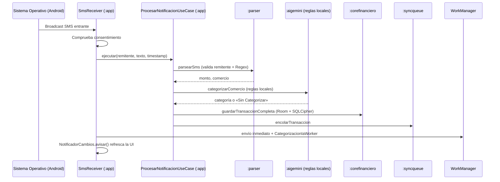
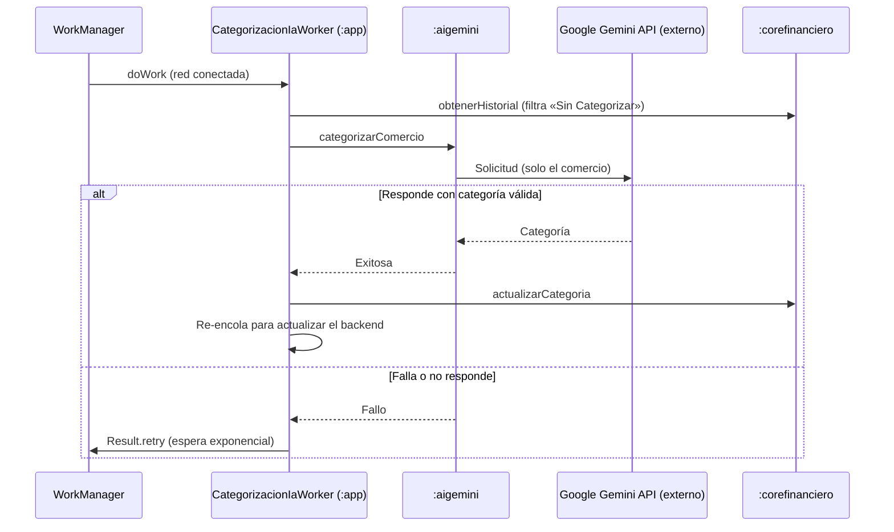
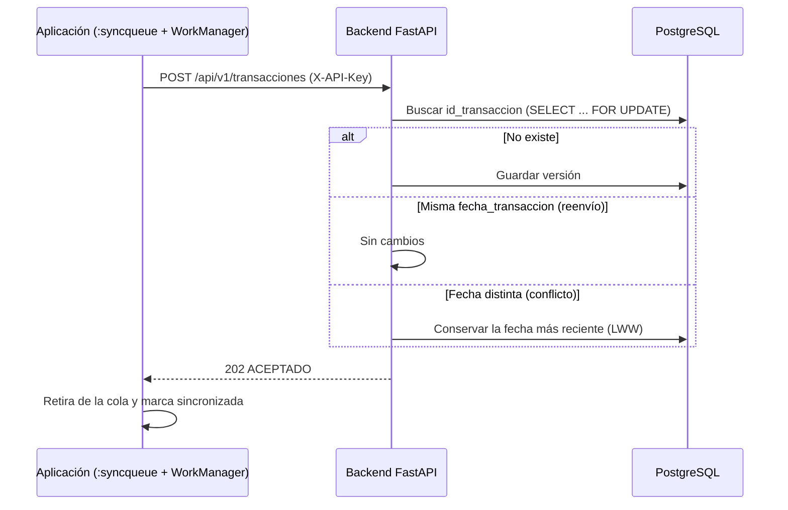
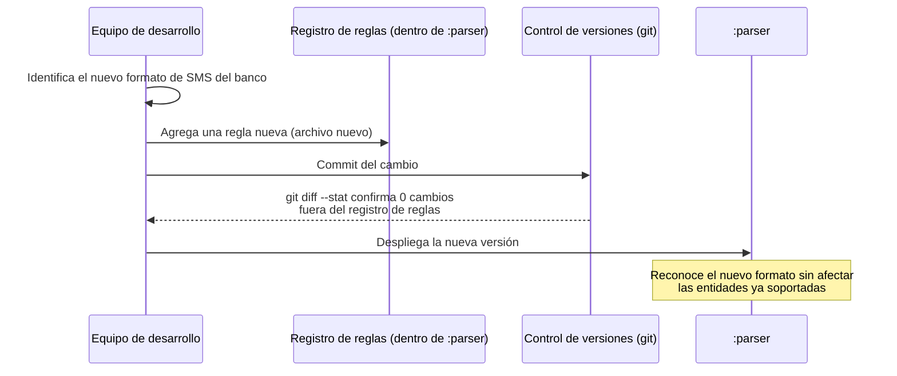
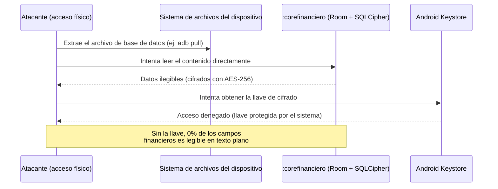

# Runtime View

Esta sección muestra, para cada uno de los 5 escenarios de calidad definidos en la Sección 10 (ESC-01 a ESC-05), cómo interactúan los módulos reales de XALD durante su ejecución. Los nombres usados corresponden a los módulos Gradle del proyecto (ver Sección 5): `:parser`, `:aigemini`, `:corefinanciero`, `:syncqueue` y `:app`. Cada escenario incluye un diagrama de secuencia UML (formato Mermaid, renderizado automáticamente por GitHub) además de la descripción paso a paso.

## 6.1 Runtime Scenario 1 — Captura, Parsing e Inferencia Automática de SMS (verifica ESC-01)

**Motivación:** este es el flujo central del módulo A-01: describe cómo XALD convierte un SMS bancario en una transacción financiera guardada, sin que el usuario tenga que hacer nada, incluso sin conexión a internet.

**Pasos del escenario:**

1. **Recepción del evento:** el sistema operativo Android recibe un SMS del banco y activa el `SmsReceiver` del módulo `:app`, que primero comprueba el consentimiento del usuario.
2. **Validación y parsing:** `ProcesarNotificacionUseCase` llama a `:parser` (`parsearSms`), que valida el remitente contra la regla bancaria y extrae monto y comercio con expresiones regulares. Si el remitente no está autorizado o el formato no se reconoce, no se crea nada.
3. **Categorización inmediata:** si es un gasto, el orquestador usa las reglas locales (`CategorizadorLocal`, 0 ms de red). Si no reconoce el comercio, queda «Sin Categorizar».
4. **Persistencia local:** `:corefinanciero` guarda la transacción en Room (base cifrada con SQLCipher) con un identificador determinista calculado del propio SMS; si el mismo SMS llega dos veces, el segundo se rechaza.
5. **Encolado:** el orquestador agrega el payload a la cola de `:syncqueue` (también en Room cifrada).
6. **Trabajo diferido y UI:** `SmsReceiver` pide el envío inmediato a WorkManager, programa `CategorizacionIaWorker` (Gemini) para los «Sin Categorizar», revisa las alertas de presupuesto y llama a `NotificadorCambios.avisar()` para refrescar la UI.

**Aspectos notables:** la IA nunca bloquea el flujo — en la ingesta solo se usan reglas locales; Gemini corre después, en segundo plano. Esto es lo que le da a XALD su característica de captura rápida y no bloqueante.

---

## 6.2 Runtime Scenario 2 — Indisponibilidad del Servicio de Categorización (verifica ESC-02)

**Motivación:** este escenario detalla qué pasa exactamente cuando la Gemini API falla, algo que en el Escenario 1 solo se mencionaba de forma general. Los tiempos de espera y el número de reintentos vienen de la medida ya definida en la Sección 10 (umbral de 5 s, máximo 3 reintentos con espera creciente, 0 transacciones perdidas); la reclasificación posterior la hace `CategorizacionIaWorker`.

**Pasos del escenario:**

1. `CategorizacionIaWorker` (WorkManager, con red conectada) toma las transacciones en «Sin Categorizar» y pide la categoría a Gemini (`CategorizadorGemini`, SDK).
2. `CategorizadorGemini` usa un timeout de 60 s por modelo y prueba 2 modelos en orden; si ninguno responde, el worker pide a WorkManager reintentar con espera exponencial (30 s inicial).
3. Si Gemini no responde, la transacción ya está guardada como «Sin Categorizar»: nunca se bloquea ni se pierde.

> **Nota — reclasificación implementada.** `CategorizacionIaWorker` ya reclasifica las transacciones «Sin Categorizar» cuando hay conexión y re-encola la transacción corregida. Límite conocido: el backend toma un reenvío con la misma `fecha_transaccion` como duplicado ([ADR-0019](../adr/0019-persistencia-remota-postgres.md), punto abierto «propagar ediciones»), así que la categoría corregida queda en el teléfono.

**Aspectos notables:** el diseño garantiza el umbral de "0 transacciones perdidas" porque el registro nunca depende de que la IA responda — la categorización es un enriquecimiento posterior, no un requisito para guardar el gasto.

---

## 6.3 Runtime Scenario 3 — Resolución de Conflictos al Sincronizar (verifica ESC-05)

**Motivación:** este escenario extiende el flujo general de sincronización al caso específico de la Sección 10: el backend recibe dos versiones de la misma transacción y decide con Last-Write-Wins.

**Pasos del escenario:**

1. La app guarda la transacción en Room y la encola en `:syncqueue`.
2. WorkManager (periódico cada 15 min o envío inmediato, con red conectada) ejecuta `procesarPendientes`.
3. `TransporteHttpSincronizacion` hace `POST /api/v1/transacciones` con `X-API-Key`.
4. El backend compara `id_transaccion` y `fecha_transaccion` en PostgreSQL (`repositorio.registrar`): si es nueva la guarda; si es un reenvío idéntico no cambia nada; si es un conflicto, gana la `fecha_transaccion` más reciente.
5. El backend responde `202` con `estado: "ACEPTADO"`; la cola retira el mensaje solo con un `2xx` y la app marca la transacción como sincronizada.
6. No hay descarga de cambios al teléfono: si otro dispositivo ganó, este no actualiza su copia local. Eso queda como trabajo futuro.

**Aspectos notables:** este es el escenario de mayor riesgo técnico del árbol de utilidad (Riesgo: Alta), porque depende de que los relojes de ambos dispositivos sean razonablemente confiables para que LWW elija correctamente. No se verificó con dos dispositivos reales (ver ESC-05).

---

## 6.4 Runtime Scenario 4 — Incorporación de una Nueva Entidad Bancaria (verifica ESC-03)

**Motivación:** a diferencia de los escenarios anteriores, este no ocurre en producción sino en tiempo de desarrollo — describe cómo el equipo agrega soporte para un banco nuevo sin modificar el código de los bancos ya soportados (objetivo de Modificabilidad).

**Pasos del escenario:**

1. El equipo de desarrollo identifica el formato de SMS de una entidad bancaria no soportada.
2. Se agrega **un archivo nuevo** al registro de reglas dentro del módulo `:parser`, sin tocar los archivos de las entidades ya soportadas.
3. Se hace commit del cambio; `git diff --stat` confirma que solo se modificó el registro de reglas (0 cambios fuera de él).
4. Se despliega la nueva versión del módulo `:parser`.
5. A partir de ese momento, `:parser` reconoce el nuevo formato sin afectar el comportamiento de los bancos existentes.

**Aspectos notables:** este escenario es el que justifica directamente la decisión del ADR-0002 (Parsing Híbrido) — la separación en un registro de reglas dentro de `:parser` es lo que hace posible este bajo esfuerzo de modificación (≤ 4 h, según la medida de ESC-03).

---

## 6.5 Runtime Scenario 5 — Protección de Datos Almacenados ante Acceso No Autorizado (verifica ESC-04)

**Motivación:** este escenario describe qué pasa si alguien obtiene acceso físico al dispositivo (perdido o robado) e intenta leer la información financiera directamente del almacenamiento.

**Pasos del escenario:**

1. Un atacante con acceso físico extrae el archivo de base de datos del dispositivo (por ejemplo, con `adb pull`).
2. Intenta leer el contenido directamente con herramientas como `strings` o `sqlite3`.
3. El contenido resulta ilegible porque `:corefinanciero` lo guarda en una base cifrada con SQLCipher (AES-256).
4. El atacante intentaría obtener la llave de cifrado, pero esta vive en el Android Keystore, protegida por el hardware/cuenta del dispositivo y nunca se guarda junto a los datos.
5. Sin la llave, el 0% de los campos financieros es legible en texto plano.

**Aspectos notables:** este escenario verifica directamente la restricción RL-01 (Habeas Data) y RT-03 — la seguridad no depende de ocultar el archivo, sino de que sea inútil sin la llave, que es la práctica correcta de cifrado en reposo. La lógica de la llave está probada en JVM (`CifradoBaseLocalTest`); la lectura con `adb pull` y `strings` sobre un equipo real aún no está registrada como evidencia.
