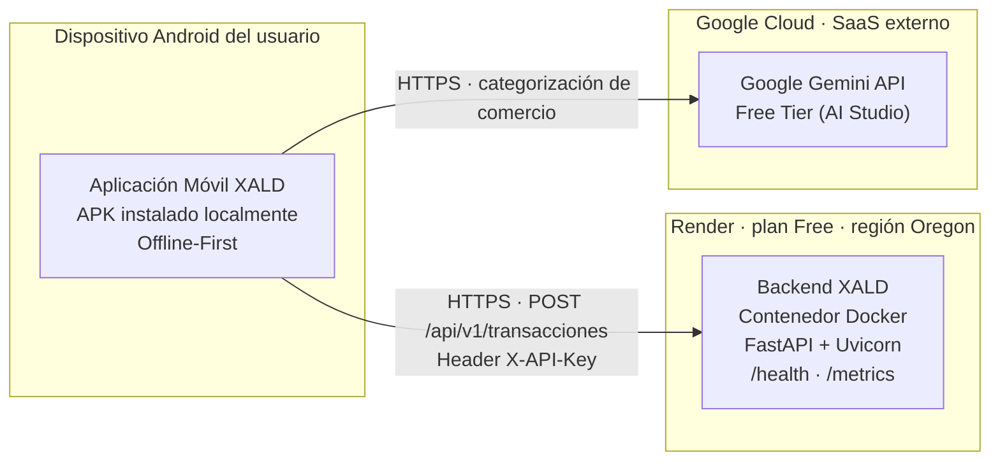

# Deployment View

Esta sección muestra dónde corre físicamente cada pieza del sistema XALD y qué costo mensual implica mantenerlas en línea, complementando la vista lógica de la Sección 5 (Building Block View) con la infraestructura real sobre la que se despliega cada contenedor.

## 7.1 Infraestructura de Despliegue

XALD se despliega sobre tres piezas de infraestructura independientes, una por cada contenedor o sistema externo identificado en el C1 y el C2:

| Pieza | Dónde corre | Cómo se despliega | Notas |
| :--- | :--- | :--- | :--- |
| **Aplicación Móvil XALD** (`:app`, `:parser`, `:corefinanciero`, `:syncqueue`, `:aigemini`) | Dispositivo Android del usuario | APK distribuido por GitHub Releases e instalado localmente ([ADR-0009](../adr/0009-distribucion-app.md)) | No requiere servidor: guarda primero en el dispositivo (Offline-First, RT-02). |
| **Backend XALD** | [Render](https://render.com), *Web Service* tipo Docker, plan **Free**, región **Oregon** | Definido como código en [`render.yaml`](../../render.yaml); imagen construida desde [`backend/Dockerfile`](../../backend/Dockerfile); desplegado por el job `deploy-backend` del CI mediante el secreto `RENDER_DEPLOY_HOOK` ([ADR-0008](../adr/0008-plataforma-de-despliegue.md)) | URL pública: `https://xald-backend.onrender.com`. Health check en `/health`, métricas en `/metrics` ([ADR-0010](../adr/0010-observabilidad.md)). `XALD_API_KEY` vive en Render → Environment, nunca en el repositorio. |
| **Google Gemini API** | Infraestructura de Google Cloud (SaaS, fuera de la frontera del sistema) | Consumida vía HTTPS desde `:aigemini` (`CategorizadorGemini`) con una llave de Google AI Studio, capa gratuita | Solo se envían el nombre del comercio y el monto (RL-01); si falla, aplica el flujo de reintentos de ESC-02. |

**Aspectos notables:** ninguna de las tres piezas requiere infraestructura administrada por el equipo, consecuencia directa de RO-01, RO-02 y RO-03.

**Estado actual:** el Backend XALD está desplegado y en línea. Las dos flechas que salen del dispositivo representan el diseño: la app todavía no llama al backend ni a Gemini (`CategorizadorGemini` es un *stub* local), por lo que esas conexiones se activan cuando se implementen los clientes HTTP de `:syncqueue` y `:aigemini`.

## 7.2 Costo Mensual

Estimación de costo bajo el supuesto de volumen indicado, con las tarifas vigentes en las fuentes citadas (consultadas el 27 de septiembre de 2026).

**Volumen supuesto:** 50 usuarios activos, cada uno generando en promedio 5 transacciones al día → **~7 500 transacciones al mes**, cada una sincronizada con el backend, y un número similar de posibles consultas a Gemini en el peor caso (todos los comercios ambiguos, ESC-01 Caso B), es decir **~250 consultas al día**.

| Pieza | Capa usada | Límite de la capa gratuita | Costo con el volumen supuesto | Fuente (fecha de consulta) |
| :--- | :--- | :--- | :--- | :--- |
| **Render** (Backend, Web Service Docker) | Free | 750 h/mes de instancia, 512 MB RAM, 0.1 CPU; se duerme tras 15 min sin tráfico | **$0/mes** — 7 500 peticiones al mes son un tráfico muy bajo para una instancia | [render.com/pricing](https://render.com/pricing) (27 sep 2026) |
| **Google Gemini API** (`:aigemini`) | Free Tier (Google AI Studio) | Del orden de cientos a ~1 500 solicitudes al día según el modelo Flash usado | **$0/mes** — ~250 solicitudes al día, dentro de la cuota de los modelos con mayor límite (ver punto de ruptura) | [ai.google.dev/gemini-api/docs/pricing](https://ai.google.dev/gemini-api/docs/pricing) y [ai.google.dev/gemini-api/docs/rate-limits](https://ai.google.dev/gemini-api/docs/rate-limits) (27 sep 2026) |
| **Aplicación Android** | GitHub Releases | Gratuito para repositorios públicos | **$0/mes** | — |
| **Total estimado** | | | **$0/mes** | |

**Punto de ruptura (cuándo deja de ser gratis):**

- **Render:** un servicio encendido todo el mes consume ~730 h, así que las 750 h gratuitas alcanzan para **una sola instancia**. La capa se rompe al agregar un segundo servicio o una segunda instancia para escalar, o cuando el tráfico exija más de 512 MB de RAM. El siguiente escalón es el plan **Starter** (~USD $7/mes).
- **Gemini API:** se rompe cuando las consultas diarias superan el límite del modelo gratuito. Con 5 transacciones por usuario al día, todas ambiguas, el punto de ruptura es **límite diario ÷ 5 usuarios**: con un modelo de ~1 500 solicitudes al día, unos **300 usuarios**; con un modelo de cuota menor, el supuesto de 50 usuarios puede quedar cerca del límite. A partir de ahí hay que habilitar facturación, que se cobra por token.
- Con el supuesto de 50 usuarios, Render queda lejos de su límite. Gemini es la pieza más sensible, y por eso la categorización es no bloqueante: si se agota la cuota, la transacción se guarda como *Sin Categorizar* (ESC-02) y no se pierde ningún registro.

> **Nota de trazabilidad:** `CategorizadorGemini` (`XALDAPP/aigemini/src/main/java/CategorizadorGemini.kt`) es un *stub* local que todavía no hace llamadas reales a Gemini. El costo de esa pieza es una proyección, no un gasto ya incurrido.

# Cross-cutting Concepts
## 8.1 Context Map (Mapa de Contextos)
Cada módulo del proyecto representa un **Bounded Context** (Contexto Delimitado) con responsabilidades claras y un vocabulario propio, evitando la filtración de lógica o datos hacia otros dominios.

| Módulo | Contexto | Responsabilidad |
| :--- | :--- | :--- |
| **`:app`** | Presentación | Interfaz gráfica (Jetpack Compose), orquesta las llamadas a los demás módulos y muestra saldo/reportes al usuario. |
| **`:parser`** | Ingesta | Recibe el SMS crudo del sistema operativo y lo interpreta mediante el Motor de Parseo (Regex). |
| **`:aigemini`** | Categorización | Traduce las respuestas de la API externa de Gemini al formato de dominio propio mediante una Capa Anticorrupción (ACL). |
| **`:corefinanciero`** | Núcleo Financiero | Dueño único de la transacción persistida; expone su interfaz pública para que otros módulos consulten sin tocar la base de datos. |
| **`:syncqueue`** | Sincronización | Gestiona la cola de transacciones pendientes y coordina el envío de lotes hacia el Backend XALD. |
| **Backend XALD** | Externo | Servicio fuera de los módulos Gradle móviles. Recibe los lotes de `:syncqueue` vía REST/HTTPS. |

---

## 8.2 Diccionario de Lenguaje Ubicuo

| Término (ES) | Módulo (Contexto) | Tipo | Significado |
| :--- | :--- | :--- | :--- |
| `TransaccionProcesadaDTO` | `:parser` | Dato en memoria (DTO) | Objeto temporal que representa una transacción interpretada por el Motor de Parseo antes de ser persistida. Sin identidad de base de datos. |
| `ParseoSms` | `:parser` | Componente (Regex) | Componente interno que aplica expresiones regulares al SMS crudo del sistema operativo para extraer datos financieros. |
| `CategorizadorGemini` | `:aigemini` | Traductor (ACL) | Capa Anticorrupción que adapta la respuesta de la API externa de Gemini al dominio local, aislando el sistema de cambios externos. |
| `TransaccionEntidad` | `:corefinanciero` | Entidad persistida (BD) | Representación permanente de la transacción en SQLite/Room. Fuente primaria de verdad (*Offline-First*) cifrada con AES-256. |
| `InformacionFinanciera` | `:corefinanciero` | Interfaz pública | Contrato que expone el Núcleo Financiero a otros módulos (`:app`, `:syncqueue`) para consultar datos de forma segura. |
| `PayloadSincronizacionDTO` | `:corefinanciero` $\rightarrow$ `:syncqueue` | Dato en tránsito (DTO) | Objeto de solo lectura empaquetado por el núcleo financiero. Sirve de contrato seguro para enviar datos al Backend sin exponer la tabla original. |
| `ColaSincronizacion` | `:syncqueue` | Gestor (Cola) | Componente que administra las transacciones pendientes de envío al Backend XALD, asegurando resistencia a desconexiones y tránsito seguro vía TLS 1.3. |
| `ServicioParser` | `:parser` | Interfaz pública | Contrato que expone el contexto de Ingesta. Recibe el texto crudo del SMS y devuelve un `TransaccionProcesadaDTO`, manteniendo oculta la implementación `ParseoSms` mediante el modificador `internal`. |
| `ServicioCategorizacion` | `:aigemini` | Interfaz pública | Contrato que expone el contexto de Categorización. Recibe el nombre del comercio y devuelve un `CategoriaResultado`, sin permitir que tipos propios de la API externa crucen la frontera del módulo. |
| `CategoriaResultado` | `:aigemini` | Dato en memoria (DTO) | Resultado ya traducido por la Capa Anticorrupción. Contiene el nombre de la categoría y el nivel de confianza expresados en el vocabulario del dominio propio, no en el del proveedor externo. |
| `GestorCoreFinanciero` | `:corefinanciero` | Componente (Persistencia) | Implementación interna del Núcleo Financiero. Genera el identificador único de cada transacción, convierte los datos recibidos en `TransaccionEntidad` y empaqueta los pendientes como `PayloadSincronizacionDTO`. |
| `ColaSincronizacionService` | `:syncqueue` | Interfaz pública | Contrato que expone el contexto de Sincronización. Permite encolar un `PayloadSincronizacionDTO` y consultar los pendientes, manteniendo oculta la implementación `ColaSincronizacion`. |
| `ProcesarNotificacionUseCase` | `:app` | Orquestador (Caso de uso) | Componente de la capa de aplicación que coordina el ciclo completo de una transacción invocando únicamente los contratos públicos de los cuatro contextos de dominio, sin conocer sus implementaciones internas. |

---

## 8.3 Tipos de Relación entre Contextos (DDD)

| Origen | Destino | Tipo de Relación (DDD) | Justificación Teleológica |
| :--- | :--- | :--- | :--- |
| `:parser` | `:corefinanciero` | **Customer-Supplier** | `:parser` entrega `TransaccionProcesadaDTO` y `:corefinanciero` lo transforma a `TransaccionEntidad` antes de guardar. Hay mapeo directo entre dominios. |
| `:aigemini` | Gemini API (Externo) | **Anti-Corruption Layer (ACL)** | `CategorizadorGemini` aísla el modelo de dominio interno de las variaciones y tipos crudos de la API externa. |
| `:corefinanciero` | `:app` | **Customer-Supplier** | `:app` consume los servicios financieros mediante la interfaz pública `InformacionFinanciera`, respetando el contrato expuesto por el proveedor. |
| `:corefinanciero` | `:syncqueue` | **Customer-Supplier** | `:corefinanciero` despacha un `PayloadSincronizacionDTO` de solo lectura a `:syncqueue` a través de su interfaz pública, evitando accesos directos a la base de datos. |
| `:syncqueue` | Backend XALD (Externo) | **Customer-Supplier** | `:syncqueue` entrega lotes formateados al Backend mediante REST/HTTPS; el servidor actúa como el proveedor remoto del estado consolidado. |

---

## 8.4 Enlace a Atributos de Calidad (`docs/aspectos.md`)
* **Offline-First (A-01):** `TransaccionEntidad` es la fuente primaria de verdad local. `ColaSincronizacion` retiene los cambios locales mientras no exista conectividad a internet.
* **Cifrado AES-256:** Cifra la persistencia en reposo de `TransaccionEntidad` dentro del contenedor del módulo `:corefinanciero`.
* **Cifrado TLS 1.3:** Protege la comunicación en tránsito en dos fronteras externas: desde `CategorizadorGemini` hacia la API de Gemini, y desde `ColaSincronizacion` hacia el Backend XALD.

Los almacenes de datos donde viven estas garantías están dibujados como contenedores propios en el C2 (`docs/c4/c2.md`, sección *Almacenes de datos y brokers*).

---

## 8.5 Diseño de idempotencia en la sincronización

### Problema

La cola de sincronización entrega las transacciones con la garantía de "al menos una vez": si el dispositivo no recibe la respuesta del backend (se corta la red o expira el tiempo), reenvía la misma transacción. Por eso el backend puede recibir la misma transacción dos veces, y ese reenvío no debe producir un segundo registro ni alterar saldos.

### Diseño

**Clave de idempotencia.** `id_transaccion` (UUID generado en el dispositivo, definido en `backend/app/dtos.py`) identifica de forma única cada transacción. El cliente la conserva en la cola hasta recibir una respuesta 2xx.

**Comportamiento del receptor** (`POST /api/v1/transacciones`):

| Caso | Condición | Respuesta | Efecto |
|---|---|---|---|
| Primera recepción | `id_transaccion` no existe | 202 `ACEPTADO` | Se guarda la versión. |
| Reenvío idéntico | mismo `id_transaccion` y misma `fecha_transaccion` | 202 `ACEPTADO` (misma respuesta) | Sin cambios. Se cuenta como duplicado, no como conflicto. |
| Conflicto real | mismo `id_transaccion`, distinta `fecha_transaccion` | 202 `ACEPTADO` | Se aplica Last-Write-Wins ([ADR-0011](../adr/0011-resolucion-conflictos-lww.md)) y se cuenta como conflicto resuelto. |

Con entrega "al menos una vez" y un receptor idempotente, el efecto neto es el de "exactamente una vez".

**Implementación.** `registrar_transaccion` en `backend/app/main.py` separa los dos casos: un reenvío idéntico responde 202 sin modificar `ultima_version` e incrementa `xald_sync_duplicados_total`; solo un conflicto real incrementa `xald_sync_conflictos_resueltos_total`. Lo verifican `test_mf03_reenvio_identico_es_idempotente_y_no_cuenta_como_conflicto` y `test_mf03_conflicto_real_sigue_contando_como_conflicto` en `backend/tests/test_lww.py` (modo de fallo MF-03, [Sección 11](11-Risks%20and%20Technical%20Debts.md)).

**Lado del cliente (pendiente, plan P-02 de la Sección 11).** La cola debe retirar un elemento solo cuando recibe una respuesta 2xx. Hoy `obtenerSiguienteParaSincronizar()` no lo retira y la app aún no tiene cliente HTTP.

### Saga: por qué no aplica

Una saga coordina operaciones que modifican datos en varios servicios y necesita compensaciones si una falla a mitad de camino. En XALD no se da esa situación:

* El registro de la transacción es una operación local en `:corefinanciero`, y ocurre antes de cualquier llamada externa.
* La categorización (Gemini) y la sincronización (backend) son pasos posteriores que no deshacen el registro: si fallan, se reintentan o la transacción queda "Sin Categorizar", pero no se compensa nada.
* Solo hay un servicio que escribe estado remoto (el backend), así que no hay transacción distribuida que coordinar.

Si en el futuro se extrae un servicio que también modifique estado (ver [ADR-0013](../adr/0013-extraer-o-no-integracion-gemini.md)), este argumento debe revisarse.

### Limitaciones declaradas

* El estado de deduplicación (`ultima_version`) vive en memoria y se pierde con cada reinicio o cuando Render duerme el servicio. Un reenvío posterior al reinicio se tratará como primera recepción. Se resuelve junto con la persistencia pendiente (A-02 en `aspectos.md`, plan P-04 de la Sección 11).
* La resolución depende de que el reloj del dispositivo sea confiable, riesgo ya registrado en arc42 §10.

---

## 8.6 Garantías de consistencia por operación

El modelo es Offline-First ([ADR-0001](../adr/0001-patron-offline-first.md)): el dispositivo es la fuente de verdad inmediata y el backend se pone al día de forma eventual. Cada operación real del sistema declara qué garantía de consistencia ofrece y se contrasta con el código del repositorio. Donde la implementación todavía no alcanza la garantía declarada, se dice y se enlaza al plan de la [Sección 11](11-Risks%20and%20Technical%20Debts.md).

| # | Operación (real) | Garantía declarada | Dónde se cumple en el código | Contraste con el código |
|---|---|---|---|---|
| **OP-01** | `InformacionFinanciera.guardarTransaccion(monto, comercio)` | **Fuerte local.** Escritura de efecto único por llamada: un monto no positivo se rechaza sin cambiar el estado, y lo guardado se ve de inmediato en las lecturas siguientes. | `XALDAPP/corefinanciero/src/main/java/com/proyecto/xald/corefinanciero/GestorCoreFinanciero.kt:13-24` | **Cumple en lo local.** Límites: guarda en memoria (línea 11), sin durabilidad ni cifrado hoy; sin control de concurrencia; y **no es idempotente**: cada llamada genera un `UUID` nuevo (línea 17), así que procesar dos veces el mismo SMS crea dos transacciones distintas. |
| **OP-02** | `obtenerUltimaTransaccion()` | **Lectura de la propia escritura** (*read-your-writes*) dentro del dispositivo. | `GestorCoreFinanciero.kt:26-28` | **Cumple** en un mismo proceso (lee la misma lista que escribe OP-01). Sin prueba automatizada directa. |
| **OP-03** | `obtenerPendientesSincronizacion()` | **Fuerte local.** Devuelve toda transacción local no confirmada (`sincronizado == false`) como `PayloadSincronizacionDTO`. | `GestorCoreFinanciero.kt:30-41` | **Cumple y verificada** por `XALDAPP/app/src/test/java/com/proyecto/xald/Cortevertical.kt:44-45` (tras guardar, hay 1 pendiente). Límite: nada marca `sincronizado = true`, así que la lista nunca se reduce (plan P-02). |
| **OP-04** | `ColaSincronizacionService.encolarTransaccion(payload)` | **Entrega al menos una vez, orden FIFO local** (§8.5): el elemento se conserva hasta recibir una respuesta 2xx. | `XALDAPP/syncqueue/src/main/java/ColaSincronizacion.kt:13-15` y `21-23` | **Parcial.** Conserva el elemento (nunca lo retira), pero no deduplica por `idTransaccion`, guarda en memoria y no confirma envíos (plan P-02). |
| **OP-05** | `ProcesarNotificacionUseCase.ejecutar(sms)` | **Orden «primero escribir en local, después encolar»:** el registro local ocurre antes de cualquier llamada externa y no se compensa si el encolado falla (la saga no aplica, §8.5). | `XALDAPP/app/src/main/java/ProcesarNotificacionUseCase.kt:26-37` | **Cumple el orden** (guardar en líneas 26-29, encolar en 32-37). Límites: ignora el resultado de `encolarTransaccion` y solo encola `pendientes.lastOrNull()` (línea 34); ninguna prueba lo invoca (el corte vertical repite los pasos a mano, hallazgo H-4 de `EVIDENCIA-S9.md`). |
| **OP-06** | `POST /api/v1/transacciones` | **Eventual entre dispositivos, convergente por Last-Write-Wins e idempotente por `id_transaccion`:** un reenvío idéntico responde 202 sin cambios; ante un conflicto real gana la `fecha_transaccion` más reciente ([ADR-0011](../adr/0011-resolucion-conflictos-lww.md)); el resultado no depende del orden de llegada. `202` significa «aceptada», no «persistida». | `backend/app/main.py:114-149` (idempotencia 121-128; LWW 130-138) | **Cumple y verificada** (ver Verificación 1). Límites: `ultima_version` vive en memoria (línea 60) y se pierde al reiniciar o cuando Render duerme el servicio (plan P-04); «más reciente» depende del reloj del dispositivo. |
| **OP-07** | `GET /metrics` | **Débil a propósito:** contadores monótonos por proceso; sin persistencia, se reinician con cada despliegue ([ADR-0010](../adr/0010-observabilidad.md)). | `backend/app/main.py:44-56` y `102-104` | **Cumple.** Sirve para observar, no para contabilizar. |

**Lo que el sistema NO garantiza:** que dos dispositivos vean los mismos datos al mismo tiempo, ni que el backend conserve las versiones tras un reinicio, ni que el orden de llegada coincida con el orden real de los hechos. La fuente de verdad del usuario es siempre su dispositivo.

### Verificación de dos operaciones contra la implementación

**Verificación 1 — `POST /api/v1/transacciones` (OP-06): idempotencia y Last-Write-Wins.** Promete consistencia eventual, así que se verifica **dónde se acepta el desfase y qué lo reconcilia**.

- *Garantía declarada:* un reenvío idéntico no cambia el estado ni cuenta como conflicto; con dos versiones distintas de la misma transacción gana la más reciente, sin importar cuál llegue primero.
- *Dónde se acepta el desfase:* el dispositivo responde al usuario sin esperar al backend (OP-01 y OP-05); el backend puede ir atrás del dispositivo todo el tiempo que no haya red.
- *Qué lo reconcilia:* `backend/app/main.py`. El reenvío idéntico se detecta en las líneas 121-128 (`fecha_transaccion == previa`), responde 202 y solo incrementa `xald_sync_duplicados_total`. El conflicto real se resuelve en las líneas 130-138, y `ultima_version[id]` solo se sobrescribe si la fecha entrante es mayor (líneas 130-131). El backend corre con un solo proceso (`backend/Dockerfile`, sin `--workers`) y `registrar_transaccion` no tiene ningún `await` entre leer y escribir `ultima_version`, así que la comprobación y la asignación no se intercalan.
- *Pruebas que lo verifican* (`backend/tests/test_lww.py`): `test_mf03_reenvio_identico_es_idempotente_y_no_cuenta_como_conflicto` (líneas 112-124), `test_version_antigua_no_sobrescribe_a_la_reciente` (56-63) y `test_version_reciente_gana_si_llega_despues` (48-54). Los dos órdenes de llegada terminan en la misma versión. Ejecución: `python -m pytest backend/tests/` → 11 pruebas en verde. Medición contra el sistema desplegado: `backend/scripts/medir_esc05.py` (30/30, ver [ADR-0011](../adr/0011-resolucion-conflictos-lww.md)).
- *Qué no cubre:* reinicios del servicio (plan P-04) ni relojes de dispositivo desajustados.

**Verificación 2 — `guardarTransaccion` y `obtenerPendientesSincronizacion` (OP-01 y OP-03): la escritura local se ve de inmediato.** Promete consistencia fuerte local, así que se busca **dónde es atómica**.

- *Garantía declarada:* lo guardado queda disponible en la lectura siguiente, y un monto no positivo se rechaza sin cambiar el estado.
- *Dónde se cumple:* `XALDAPP/corefinanciero/src/main/java/com/proyecto/xald/corefinanciero/GestorCoreFinanciero.kt`: línea 14 (rechazo antes de tocar el estado), línea 23 (un único `add`, que es la escritura completa) y líneas 30-41 (la proyección de pendientes se lee de la misma lista). No hay transacción de base de datos (`BEGIN`/`COMMIT`) porque todavía no hay base de datos: la atomicidad viene de que la escritura es una sola operación sobre una sola lista. Cuando exista Room, la escritura de la entidad debe ir en una transacción `@Transaction` del DAO.
- *Prueba que lo verifica:* `XALDAPP/app/src/test/java/com/proyecto/xald/Cortevertical.kt:37-45` hace `assertTrue(guardadoExitoso)` y `assertEquals(1, pendientes.size)` justo después de guardar. El CI la ejecuta con `./gradlew testDebugUnitTest`.
- *Qué no cubre:* el rechazo de montos no positivos (línea 14) no tiene prueba propia, y el almacenamiento es en memoria y sin cifrar (A-02 y A-04 siguen pendientes).

---

## 8.7 Diseño de Caché

**Estado actual:** el sistema no tiene ninguna caché implementada (no hay Redis, Memcached ni TTL en el código). Lo que sigue es un **diseño propuesto**, no código existente. Las cachés de este diseño se justifican por RO-02 (costo $0, el plan gratuito de Gemini limita las solicitudes) y por ESC-01 (respuesta rápida al registrar).

| Qué se cachea | Dónde | Cuánto dura | Por qué |
| :--- | :--- | :--- | :--- |
| Categoría por comercio (`comercio` → `CategoriaResultado`) | Tabla Room propia de `:aigemini` en el dispositivo (contenedor *Caché de categorías* del C2). Solo `:aigemini` la lee y la escribe. | Hasta que el usuario corrija la categoría; revisión máxima de 30 días. | Evita volver a consultar a Gemini por un comercio ya conocido: menos llamadas y menos consumo de la capa gratuita. |
| Saldo consolidado y totales del reporte | En memoria dentro de `:app` (estado de la pantalla) | Mientras viva la pantalla o hasta la siguiente escritura. | Evita recalcular la suma de todas las transacciones en cada redibujado. |
| Backend XALD | **No hay caché.** | — | El único estado es `ultima_version`, que es la fuente de decisión de LWW, no una copia. Cachearlo duplicaría la verdad. La API no tiene lecturas que justifiquen una caché: solo recibe escrituras. |

El plazo de 30 días es una propuesta del equipo y se ajustará con datos reales de uso.

---

## 8.8 Política de Invalidación tras Escritura

**Regla declarada:** *toda escritura invalida la caché derivada de ella antes de devolver el control.* Es invalidación por escritura (*write-invalidate*), no por tiempo, salvo el límite de 30 días de la categoría.

| Escritura | Qué se invalida | Cómo | Qué se rompe si no se invalida |
| :--- | :--- | :--- | :--- |
| `guardarTransaccion(...)` (OP-01) | Saldo consolidado y totales del reporte | `:app` descarta el valor en memoria al recibir `true` y lo recalcula en la siguiente lectura. | La pantalla muestra un saldo que no incluye la transacción recién registrada: el usuario ve un gasto en la lista pero no en el total. |
| El usuario corrige la categoría de una transacción | La entrada `comercio → categoría` de ese comercio, y los totales por categoría | Se sobrescribe con la categoría elegida por el usuario, que tiene prioridad sobre la de Gemini, y se descartan los totales. | El siguiente SMS del mismo comercio vuelve a llegar con la categoría equivocada. |
| Reclasificación posterior de «Sin Categorizar» (Sección 6.2) | Totales por categoría | Se descartan al cambiar la categoría. | El reporte por categoría sigue contando la transacción como «Sin Categorizar». |
| Vence el plazo de 30 días de una categoría | La entrada `comercio → categoría` | La siguiente consulta de ese comercio va a Gemini y reemplaza la entrada. | Un comercio que cambió de giro conserva una categoría vieja para siempre. |
| Respuesta `202` del backend | Ninguna caché | La sincronización no cambia lo que el usuario ve: su dispositivo ya tiene la versión actual. | — |

**Implementación:** ninguna. Es un plan que se implementa junto con las cachés de 8.7 y con la BD local (A-02). Cuando exista Room, la invalidación del saldo puede apoyarse en que Room avise los cambios de la tabla (consultas observables), de modo que la regla se cumpla sin código manual.

---

## 8.9 Garantías del Flujo por Eventos

El sistema no usa un broker de mensajes (ni Kafka ni RabbitMQ; ver la nota de brokers en `docs/c4/c2.md`). El único flujo por eventos es el que va del dispositivo al backend por la cola de sincronización (`:syncqueue`), y su garantía es:

**Entrega al menos una vez, con consumo idempotente (efecto neto: una sola vez).**

* **Qué asume:**
  1. Cada transacción tiene un UUID único desde el origen (`id_transaccion`).
  2. La cola solo retira un elemento cuando el backend responde `202`; si no responde, se reenvía.
  3. Reenviar la misma transacción no cambia el resultado, porque el backend la identifica por UUID y aplica idempotencia y LWW (§8.5, [ADR-0011](../adr/0011-resolucion-conflictos-lww.md)).
  4. Los relojes de los dispositivos son razonablemente confiables.
* **Por qué no «como máximo una vez»:** perdería transacciones cada vez que se cae la red, lo que rompe ESC-05 (0 transacciones perdidas).
* **Por qué no «exactamente una vez» a nivel de red:** exigiría coordinación transaccional entre el dispositivo y el backend, que no es posible con la red intermitente que asume Offline-First. Se obtiene el mismo efecto con al menos una vez más un receptor idempotente.
* **Qué NO garantiza:** orden global entre transacciones distintas. Si el mismo payload llega dos veces, el contador `xald_transacciones_recibidas_total` sí lo cuenta dos veces (se incrementa en `main.py:115`, antes de la comprobación de idempotencia), aunque el dato no se duplica (MF-03, Sección 11).
* **Estado:** el reenvío idempotente está implementado en el backend. Falta que la cola retire lo confirmado y que el cliente HTTP exista (Sección 11, MF-01, MF-03, planes P-01 y P-02).
