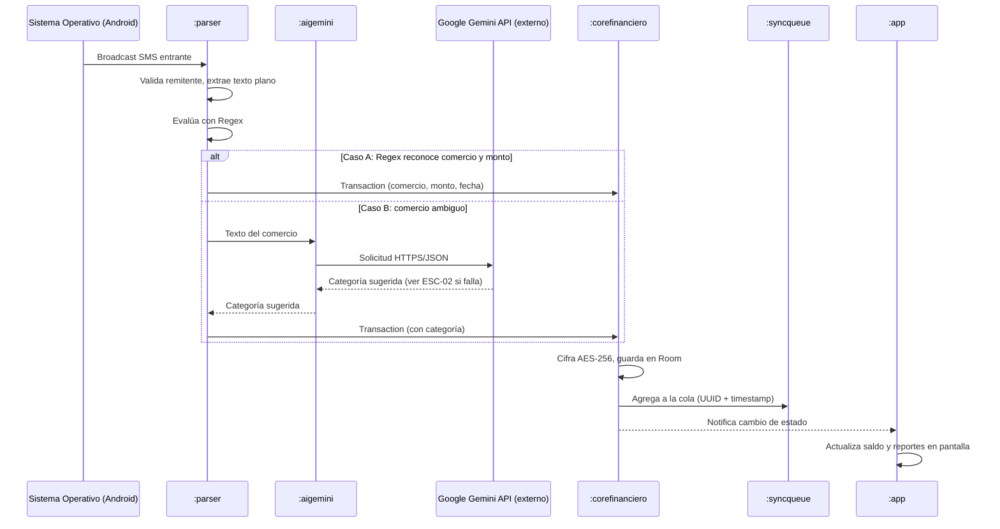
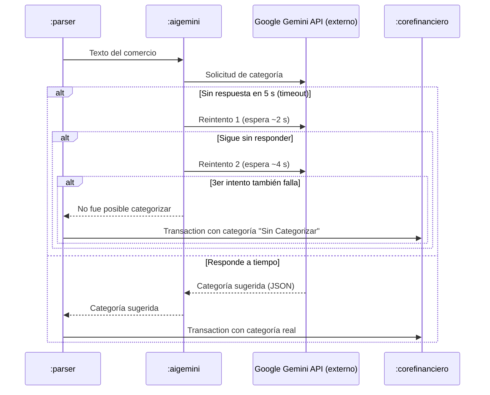
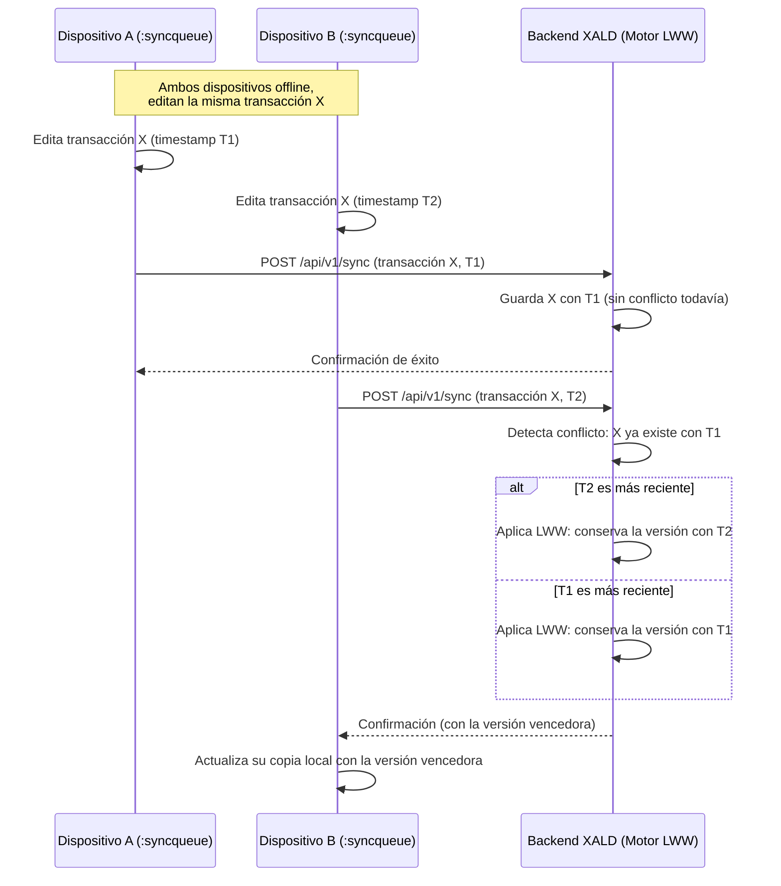
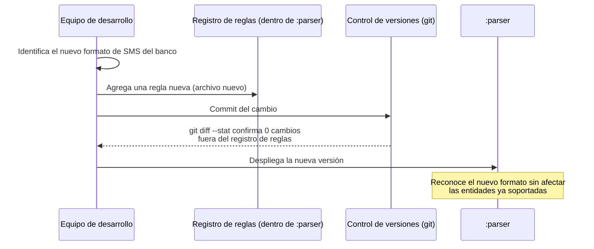
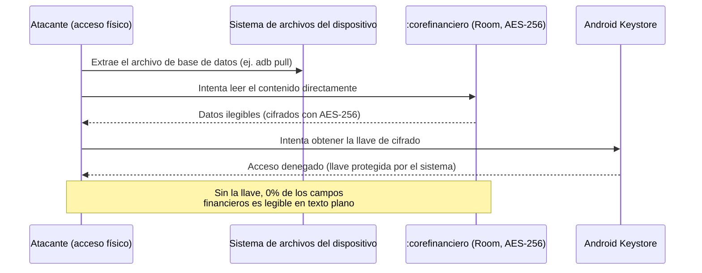

# Introduction and Goals

Esta sección presenta una visión general de XALD: qué problema resuelve, cómo funciona, qué objetivos de negocio y de calidad persigue y quiénes son las partes interesadas. Sirve como punto de entrada para el resto de la documentación de arquitectura.

## Requirements Overview

En la gestión financiera personal actual se identifican dos limitaciones estructurales que XALD busca resolver:

- **Fricción en la entrada de datos (carga cognitiva).** Anotar cada transacción a mano toma tiempo; al cabo de pocas semanas el usuario abandona la app, generando pérdida de integridad del historial financiero ("gastos hormiga" no registrados).
- **Dependencia estricta de conectividad (acoplamiento a red).** Si el usuario no tiene datos o la señal es mala, la mayoría de apps no abren o no permiten registrar nada.

**Solución propuesta:** una app móvil que registra los gastos con mínima intervención del usuario, leyendo automáticamente notificaciones/SMS bancarios, y que funciona sin internet para mostrar la información al instante (offline-first).

**Cómo funciona el sistema (flujo de datos):** XALD funciona como una tubería de datos (pipeline) de 4 pasos:

1. **Captura:** vía SMS/notificación bancaria, leída automáticamente en segundo plano.
2. **Validación y limpieza:** se extraen fecha, monto y comercio, verificando que los datos sean válidos.
3. **Categorización inteligente:** el nombre del comercio se envía a una API de IA (Gemini API, capa gratuita) que devuelve la categoría del gasto (ej. "Alimentación").
4. **Guardado local:** la transacción categorizada se persiste cifrada en el dispositivo (SQLite + SQLCipher, cifrado AES-256), visible al instante aunque no haya internet.

**Resiliencia:** si no hay internet o la IA no responde, el gasto se guarda igual bajo "Sin Categorizar" y se reclasifica automáticamente al volver la señal — nunca se pierde un dato. Las transacciones pendientes de sincronizar viven en una Sync Queue que garantiza orden cronológico exacto (timestamps/UUIDs) al reconectar, evitando duplicados o saldos sobrescritos.

## Business Goals

Los siguientes son los objetivos de negocio que justifican la existencia del sistema. Cada uno indica a qué interesado le importa y por qué. Los objetivos de calidad de la sección siguiente se derivan de estos.

| ID | Objetivo de negocio | Interesado principal | Por qué le importa |
|---|---|---|---|
| **OB-01** | Eliminar la fricción en la entrada de datos, que es la causa del abandono de la app y de la pérdida de integridad del historial financiero | Usuario final | Quiere el control de sus gastos sin dedicar tiempo diario a registrarlos a mano |
| **OB-02** | Desacoplar la aplicación de la conectividad, de modo que sea utilizable con o sin señal | Usuario final | Registra y consulta gastos en zonas sin cobertura o con datos agotados |
| **OB-03** | Tratar la información financiera conforme a la Ley 1581 de 2012 | Usuario final · Equipo de desarrollo | El usuario confía datos sensibles; el equipo responde legalmente por su tratamiento |
| **OB-04** | Sostener la cobertura de entidades bancarias sin reescribir el sistema cada vez que una cambie el formato de sus mensajes | Equipo de desarrollo | Un formato no soportado deja sin servicio a un segmento de usuarios |

## Quality Goals

Cada objetivo de calidad se deriva de un objetivo de negocio y se verifica mediante un escenario de la sección 10.

| # | Objetivo de calidad | Descripción | Objetivo de negocio | Escenario |
|---|---|---|---|---|
| 1 | Disponibilidad (offline-first) | Leer y escribir datos sin señal; el usuario nunca ve un error de red al registrar un gasto. | OB-02 | ESC-01 |
| 2 | Resiliencia | Si la IA falla o no responde, la app sigue funcionando con normalidad (categoría "Sin Categorizar" temporal). | OB-01 | ESC-02 |
| 3 | Seguridad básica | Proteger la base de datos local contra lecturas no autorizadas (cifrado SQLCipher/AES-256). | OB-03 | ESC-04 |
| 4 | Consistencia eventual | Al reconectar, la Sync Queue sube las transacciones en orden cronológico correcto sin duplicar ni sobrescribir saldos. | OB-02 | ESC-05 |
| 5 | Modificabilidad | Incorporar el formato de una nueva entidad bancaria sin modificar el código de las ya soportadas. | OB-04 | ESC-03 |

**Escenarios de calidad medibles:** los escenarios completos, con sus seis partes (fuente, estímulo, artefacto, entorno, respuesta y medida) y sus medidas verificables (umbral, carga y herramienta), se detallan en la sección 10 (Quality Requirements).

**Restricciones clave:**
- **Presupuesto:** $0 — solo bibliotecas open-source y capas gratuitas de APIs.
- **Privacidad (Ley 1581 de Colombia):** a la IA solo se le envía el nombre del comercio y el monto; nunca se envían nombres de usuarios ni números de cédula/cuenta.

## Stakeholders

| Rol | Contacto | Expectativas | Objetivo asociado |
| --- | --- | --- | --- |
| Usuario final | Interactúa con la app móvil | Registrar y consultar sus finanzas con mínima fricción, sin depender de señal | OB-01 · OB-02 |
| Usuario final | Interactúa con la app móvil | Que su información financiera no sea legible si pierde el dispositivo | OB-03 |
| Equipo de desarrollo (nosotros) | Diseña, implementa y documenta cada incremento | Entregar una arquitectura clara, documentada y sostenible en un semestre | OB-04 |
| Docente / Evaluador (UTB) | Revisa el repositorio de GitHub y los entregables incrementales | Verificar que la documentación (arc42) corresponda con el repositorio | Todos |
| Servicio externo de IA (Gemini) | Se consulta vía API; no almacena datos personales del usuario | Recibir solo datos anonimizados (comercio + monto) para categorizar | OB-03 |

# Architecture Constraints

Estas son las condiciones que ya vienen dadas para el proyecto y que no podemos cambiar. No son decisiones de diseño que tomamos nosotros por gusto, sino cosas que limitan desde antes cómo se puede construir XALD.

## Restricciones Técnicas

- **RT-01 (Exclusividad de Sistema Operativo):** La app se va a desarrollar solo para Android. La razón es que leer los SMS automáticamente en segundo plano (usando BroadcastReceiver y el permiso RECEIVE_SMS) es algo que solo se puede hacer de esa forma en Android; otros sistemas móviles no dejan que una app lea mensajes de texto así por sus políticas de seguridad. *(Origen: limitación técnica de la plataforma)*

- **RT-02 (Arquitectura Offline-First):** La información se guarda primero de forma local, en una base de datos SQLite con cifrado (Cipher). Leer y escribir datos no depende de tener internet. *(Origen: decisión de arquitectura del equipo, a partir del problema de conectividad intermitente)*

- **RT-03 (Seguridad de Datos Locales):** La base de datos local se cifra con AES-256, y las llaves que la protegen se manejan a través del Android Keystore. *(Origen: buena práctica de seguridad para el manejo de datos financieros sensibles)*

- **RT-04 (Ingesta por Inferencia / Regex):** XALD depende de leer e interceptar los mensajes de texto (SMS) que mandan los bancos, en lugar de usar una API bancaria oficial (Open Banking). Esto significa que si un banco cambia el formato de sus mensajes, XALD se puede ver afectado y toca ajustar la forma en que los lee. *(Origen: ausencia de APIs bancarias abiertas/Open Banking disponibles para el equipo)*

- **RT-05 (Consistencia Sencilla LWW):** Cuando hay un cruce entre lo que pasó en el celular y lo que hay en el servidor, gana la transacción más reciente (esto se conoce como Last-Write-Wins o LWW). Para saber cuál es la más reciente se usan marcas de tiempo y códigos únicos (UUIDs) dentro de la fila de espera (Sync Queue). *(Origen: decisión de arquitectura del equipo para resolver conflictos de sincronización)*

## Restricciones Organizacionales y de Proyecto

- **RO-01 (Límite Semestral y Equipo):** El desarrollo está limitado al alcance de un semestre académico y lo hace un equipo de estudiantes. Por eso el primer incremento del proyecto se enfoca solo en el módulo A-01 (recepción y procesamiento de notificaciones). *(Origen: limitación de tiempo y tamaño del equipo, propia del curso académico)*

- **RO-02 (Costo $0 / Presupuesto):** El proyecto tiene que usar únicamente servicios en sus capas gratuitas, como Google AI Studio / Gemini API (Free Tier), e infraestructura que no tenga costo. *(Origen: limitación de presupuesto del equipo estudiantil)*

## Restricciones Legales

- **RL-01 (Protección de Datos Personales — Habeas Data):** Como XALD maneja información financiera personal (saldos, movimientos bancarios, categorías de gasto), el desarrollo tiene que respetar la Ley 1581 de 2012, que desarrolla el derecho de las personas a conocer, actualizar y rectificar la información que hay sobre ellas en bases de datos (lo que se conoce como Habeas Data), en concordancia con los artículos 15 y 20 de la Constitución Política de Colombia. En la práctica, esto significa que el usuario debe poder ver, corregir y eliminar sus datos personales dentro de la app, y que XALD no puede usar esa información para fines distintos a los que el usuario autorizó — esto también explica por qué en el flujo con Gemini API solo se envía el nombre del comercio y el monto, sin datos como cédula o número de cuenta. *(Origen: normativa nacional — Ley 1581 de 2012, Artículo 1º)*

# Context and Scope

## Business Context

Aquí se muestra quién o qué interactúa con XALD desde afuera, sin entrar en detalles técnicos de cómo se comunican. Esta tabla está alineada con el diagrama de Contexto (C1) del modelo C4: solo se listan los actores y sistemas que están fuera de la frontera del sistema XALD.

| Actor / Sistema externo | Descripción | Entradas hacia XALD | Salidas desde XALD |
| --- | --- | --- | --- |
| **Usuario Final** | Propietario de la información financiera | Corrección manual de categorías, registros manuales, consultas de reportes | Visualización de saldo, historial de transacciones, reportes de gasto |
| **SO Android / Entidades Bancarias (SMS)** | Sistema operativo que entrega las notificaciones/SMS emitidos por las entidades bancarias | Mensaje de texto (SMS) con monto, comercio y fecha | *Ninguna — el conector es unidireccional (ver C1): XALD solo escucha, no le responde nada al SO ni al banco* |
| **Google Gemini API** | API de IA externa para la inferencia de categorías de gasto | Categoría sugerida en formato JSON | Cadena de texto limpia del comercio / origen |

**Nota de alcance:** el Backend XALD se representa **dentro de la frontera del sistema XALD** (subgrafo "Sistema XALD · Frontera del proyecto" en el C1), no como actor externo — por eso no tiene fila propia en la tabla de arriba. Con la actualización del diagrama, la conexión entre la Aplicación XALD y el Backend XALD ya aparece explícita dentro del propio C1 como el **conector 4 (Sincronización REST)**, aunque su función interna se sigue detallando a fondo en el nivel de Contenedores (C2). Ver `docs/c4/c4.md`.

La idea central es que el usuario casi no tiene que hacer nada manualmente: el sistema capta la información sola desde los SMS bancarios, usa la IA de Gemini para sugerir la categoría del gasto, y el usuario solo interviene para revisar, corregir o consultar.

## Technical Context

Acá se muestra por dónde entra y sale la información, y cómo viaja de un lado a otro. Cada fila referencia el conector numerado correspondiente del C1 (`docs/c4/c4.md`) cuando aplica. Se mantiene la columna de **Alcance** para dejar explícito cuáles interfaces cruzan la frontera del sistema (Externo), cuáles cruzan red pero permanecen dentro de la frontera (Entre Contenedores) y cuáles son llamadas internas sin red (Interno).

| Interfaz Técnica | Alcance | Canal / Protocolo | Formato de Datos | Cifrado / Seguridad |
| --- | --- | --- | --- | --- |
| SO Android/SMS → Aplicación XALD (conector 1) | Externo | Android BroadcastReceiver (Eventos del SO) | Texto plano (SmsMessage) | Permiso Android RECEIVE_SMS |
| Aplicación XALD ↔ Google Gemini API (conector 2) | Externo | HTTPS / REST (POST) | JSON (responseMimeType: application/json) | TLS 1.3 + API Key |
| Usuario Final ↔ Aplicación XALD (conector 3) | Externo | UI nativa / Reportes en pantalla | Vistas y datos locales | N/A (interacción local en el dispositivo) |
| Aplicación XALD ↔ Backend XALD (conector 4) | Entre Contenedores | HTTPS / REST (POST/PUT) | Lotes JSON (Sync Queue) | TLS 1.3 + Tokens de Sesión |
| Aplicación XALD → DB Local | Interno | Llamada interna SQLite / Room | Objetos Relacionales / Filas | AES-256 vía Android Keystore |

El diagrama de contexto formal se encuentra en `docs/c4/c4.md`. Las interfaces marcadas como **Externo** corresponden a los conectores 1, 2 y 3, que cruzan la frontera del sistema en el C1. La marcada como **Entre Contenedores** corresponde al conector 4: cruza red, pero permanece dentro de la frontera de XALD —es el caso del Backend XALD, representado dentro del recuadro del sistema— y se documenta a fondo en el nivel de Contenedores (C2). La marcada como **Interno** es una llamada en el mismo proceso, sin cruzar red, y por eso no tiene número de conector en el C1.

**INPUT/OUTPUT MAP**

```
[Banco / SMS]
        |
        |  SMS (monto, comercio, fecha)
        v
[Sistema Operativo]
        |
        |  1 · Notificación SMS (BroadcastReceiver)
        v
[Aplicación XALD] --2 · Inferencia / JSON--> [Google Gemini API]
        |          <---categoría sugerida (JSON)---
        |
        |  guardado local (cifrado AES-256)
        v
[Base de datos local]

[Aplicación XALD] <==4 · Sincronización REST==> [Backend XALD]
        (ambos dentro de la frontera del sistema XALD, ver C1)

[Usuario final] <--3 · UI / Reportes--> [Aplicación XALD]
```

# Solution Strategy

Ideas principales y enfoques de solución que definen cómo XALD resuelve el problema. Las herramientas que se mencionan más adelante son solo ejemplos de cómo se podría implementar cada idea, no una decisión cerrada; se pueden cambiar según lo que mejor funcione en el momento.

* **Para cumplir con las metas de calidad:** La app realiza una captura pasiva e ingesta automática leyendo mensajes o notificaciones del banco mediante receptores nativos (`BroadcastReceiver` / `SMS`). La IA actúa como un soporte extra no bloqueante...

* **En cuanto al patrón de arquitectura:** Se adopta un enfoque *offline-first* donde toda la información se almacena primero en el dispositivo (mediante `SQLite`/`Room`) para garantizar disponibilidad total sin internet. La sincronización con el servidor se realiza de forma asíncrona mediante una cola local (*Sync Queue*) basada en marcas de tiempo (`timestamps`) e identificadores únicos (`UUIDs`), resolviendo conflictos en el backend mediante *Last-Write-Wins* (LWW) sin bloquear la interfaz.

* **Entre las decisiones tecnológicas principales:** Se aprovechan las herramientas nativas del sistema operativo (permisos `RECEIVE_SMS` / `SmsRetriever`) ante la falta de APIs de *Open Banking* locales. Para mantener el presupuesto en **$0** y cumplir el plazo de **16 semanas**, se combina un motor local `Regex` con llamadas HTTP REST a la API de Google Gemini (vía respuestas JSON) y el uso de librerías de código abierto.

* **Para estrategias de seguridad:** Se aplica *Privacidad desde el Diseño*: hacia el servicio de IA solo se envían el nombre del comercio y el monto —omitiendo cédula, saldos o número de cuenta— para cumplir con la **Ley 1581 (Habeas Data)**. Asimismo, la información financiera almacenada en el dispositivo se protege con cifrado (`AES-256` / `Android KeyStore`) para salvaguardar los datos ante robo o acceso no autorizado.

# Building Block View

La vista de bloques de construcción muestra la descomposición de XALD en dos niveles, alineados directamente con los niveles **C1** y **C2** del modelo C4 documentado en `docs/c4/c4.md`, y con el esqueleto de arranque ya implementado (`Bootstrapper` + módulos `AppModule`).

| Bloque | Responsabilidad |
| :--- | :--- |
| **Aplicación XALD** | Es lo que ve y usa el usuario; ahí pasa todo el proceso de capturar, procesar, guardar y mostrar la información. |
| **Backend XALD** | Sincroniza y respalda las transacciones de la Aplicación XALD; vive dentro de la frontera del sistema, pero como contenedor independiente. |

*Nota de alcance: la API de Gemini y el SO Android/SMS no se listan como bloques del sistema porque, según el C1 (`docs/c4/c4.md`), son sistemas externos fuera de la frontera de XALD — ya están documentados como actores externos en la Sección 3 (Context and Scope).*

### 5.1 Nivel 1 — Sistema XALD (corresponde al C1 de `docs/c4/c4.md`)

Vista de caja blanca del sistema completo: dentro de la frontera "Sistema XALD" conviven dos contenedores principales: la **Aplicación Móvil XALD** y el **Backend XALD**, conectados a través del **conector 4 (Sincronización REST / TLS 1.3)**. Ambos completan el ciclo de vida de una transacción, siendo la Aplicación Móvil el único contenedor con el que el usuario interactúa directamente (conector 3), el que recepta notificaciones bancarias (conector 1) y el que consulta la API externa de IA (conector 2).

| 1. Aplicación Móvil XALD (Contenedor Android) | 2. Backend XALD (Contenedor Servidor) |
| :--- | :--- |
| • Ingesta e interpretación de SMS (`:parser` - `ParseoSms`) | • Servidor API REST / Endpoints HTTP |
| • Categorización inteligente via IA (`:aigemini` - `CategorizadorGemini`) | • Procesamiento y consolidación de reportes |
| • Base de datos local cifrada AES-256 (`:corefinanciero` - `TransaccionEntidad`) | • Motor de resolución de conflictos de sincronización (LWW) |
| • Gestor de cola offline en tránsito (`:syncqueue` - `ColaSincronizacion`) | • Persistencia remota (Base de Datos PostgreSQL / Respaldo) |
| • Interfaz de usuario y orquestación (`:app` - Jetpack Compose) | |

1. **Aplicación Móvil XALD:** Captura, procesa y presenta la información financiera de forma local bajo un esquema *Offline-First*. Se encarga de la ingesta de SMS, el parseo por expresiones regulares, la categorización adaptativa con IA, la persistencia cifrada (AES-256) en `SQLite/Room` y la interfaz de gestión.
2. **Backend XALD:** Expone la API REST protegida por TLS 1.3, procesa reportes globales y ejecuta la sincronización de datos entre dispositivos mediante la estrategia *Last-Write-Wins* (LWW), manteniendo la persistencia remota como respaldo consolidado del usuario..

---

### 5.2 Nivel 2 — Aplicación Móvil Android (corresponde al C2 de `docs/c4/c4.md`)

Descomposición del contenedor "Aplicación Móvil Android" en sus módulos internos, tal como aparecen en el C2: el módulo `:app` actúa como orquestador central y delega en cuatro submódulos independientes. La tabla incluye además su correspondencia con el esqueleto de código ya escrito.

| Módulo (C2) | Función | Carpeta en el esqueleto | Módulo de Inicialización |
| :--- | :--- | :--- | :--- |
| **`:app`** | Interfaz gráfica (Jetpack Compose), Dashboard y orquestador principal | `XALDAPP/app/` | `XaldApplication` |
| **`:parser`** | Receptor de eventos (BroadcastReceiver) y motor de expresiones regulares (Regex Engine) | `XALDAPP/parser/` | `ParserModule` |
| **`:aigemini`** | Cliente HTTP y SDK de Google Gemini para categorización de comercios (ACL) | `XALDAPP/aigemini/` | `AiGeminiModule` |
| **`:corefinanciero`** | Almacenamiento local cifrado (SQLite/Room con AES-256) | `XALDAPP/corefinanciero/` | `CoreFinancieroModule` |
| **`:syncqueue`** | Gestor de la cola de sincronización asíncrona (timestamps + UUIDs) | `XALDAPP/syncqueue/` | `SyncQueueModule` |

El orden de arranque definido en `ProcesarNotificacionUseCase.kt` respeta esta misma descomposición de 5 Bounded Contexts: `CoreFinancieroModule → ParserModule → AiGeminiModule → SyncQueueModule → UiModule`. Cada módulo implementa el contrato `AppModule` (con un único método `init()`), lo que permite que el `ProcesarNotificacionUseCase` los trate a todos por igual sin conocer sus detalles internos, y que si uno falla, aísle el error sin tumbar el resto de la aplicación.

**Ajuste de consistencia con el C2:** El esqueleto tenía previamente un módulo `RemoteDatabaseModule` dentro del arranque de la app. Con el C2 ya definido, ese bloque no corresponde al lado de la Aplicación Móvil — la persistencia remota vive dentro del contenedor **Backend XALD** (ver 5.1), y la app solo la alcanza a través de `:syncqueue`. Por eso se retira del `ProcesarNotificacionUseCase` de la app y queda documentado únicamente como responsabilidad del Backend XALD.

* **`:app` (Interfaz gráfica, Dashboard y orquestador principal):** implementado con Jetpack Compose; recibe el SMS del sistema operativo (conector 1) y coordina el resto de los módulos, además de exponer la UI y los reportes al usuario (conector 3).
* **`:parser` (Receptor de eventos y motor de expresiones regulares):** su `BroadcastReceiver` capta el SMS entrante y su `Regex Engine` interpreta el texto con reglas locales conocidas, delegando en `:aigemini` los casos ambiguos.
* **`:corefinanciero` (Almacenamiento local cifrado):** guarda las transacciones en SQLite/Room con cifrado AES-256, y expone el saldo y el historial al módulo `:app`.
* **`:syncqueue` (Gestor de la cola de sincronización asíncrona):** encola las transacciones pendientes usando timestamps + UUIDs y las sincroniza con el Backend XALD (conector 4) cuando hay conexión disponible.
* **`:aigemini` (Cliente HTTP y SDK de Google Gemini):** consulta la API de Gemini (conector 2) para categorizar los comercios que el motor local no puede resolver.

# Runtime View

Esta sección muestra, para cada uno de los 5 escenarios de calidad definidos en la Sección 10 (ESC-01 a ESC-05), cómo interactúan los módulos reales de XALD durante su ejecución. Los nombres usados corresponden a los módulos Gradle del proyecto (ver Sección 5): `:parser`, `:aigemini`, `:corefinanciero`, `:syncqueue` y `:app`. Cada escenario incluye un diagrama de secuencia UML (formato Mermaid, renderizado automáticamente por GitHub) además de la descripción paso a paso.

## 6.1 Runtime Scenario 1 — Captura, Parsing e Inferencia Automática de SMS (verifica ESC-01)

**Motivación:** este es el flujo central del módulo A-01: describe cómo XALD convierte un SMS bancario en una transacción financiera guardada, sin que el usuario tenga que hacer nada, incluso sin conexión a internet.

**Pasos del escenario:**

1. **Recepción del evento:** el sistema operativo Android recibe un SMS del banco y activa el BroadcastReceiver del módulo `:parser`.
2. **Filtrado:** `:parser` valida el remitente y extrae el texto plano.
3. **Parsing local (Regex):** `:parser` evalúa el texto con expresiones regulares. **Caso A (Regex exitoso):** si reconoce el comercio y el monto, genera directamente el objeto `Transaction`. **Caso B (comercio ambiguo):** envía el texto al módulo `:aigemini`, que a su vez consulta la Gemini API externa; si falla o no responde, este caso se resuelve según el flujo detallado en el **Escenario 2 (ESC-02)**.
4. **Persistencia local:** el objeto `Transaction` se envía a `:corefinanciero`, que cifra los campos con AES-256 y guarda la fila en la base de datos local (Room).
5. **Encolado para sincronización:** `:corefinanciero` notifica a `:syncqueue`, que agrega el registro a la cola de sincronización con su UUID y timestamp.
6. **Notificación a la UI:** `:corefinanciero` notifica el cambio a `:app`, que actualiza el saldo y el reporte en pantalla. *(el mecanismo exacto de notificación — StateFlow, LiveData u otro — está pendiente de confirmar contra la implementación real de `:app`)*.



**Aspectos notables:** la IA nunca bloquea el flujo — solo interviene en el Caso B, y aun así el resultado se integra al mismo camino de persistencia que el Caso A. Esto es lo que le da a XALD su característica de captura rápida y no bloqueante.

---

## 6.2 Runtime Scenario 2 — Indisponibilidad del Servicio de Categorización (verifica ESC-02)

**Motivación:** este escenario detalla qué pasa exactamente cuando la Gemini API falla, algo que en el Escenario 1 solo se mencionaba de forma general. Los tiempos de espera y el número de reintentos vienen de la medida ya definida en la Sección 10 (umbral de 5 s, máximo 3 reintentos con espera creciente, 0 transacciones perdidas); la reclasificación posterior todavía no está implementada como componente y se describe por separado, sin diagramarla como un flujo ya existente.

**Pasos del escenario:**

1. `:aigemini` envía la solicitud de categoría a la Gemini API.
2. Si no hay respuesta en **5 segundos**, se reintenta con espera creciente (propuesta: ~2 s, luego ~4 s).
3. Si los 3 intentos fallan, `:aigemini` devuelve a `:parser` que no fue posible categorizar, y la transacción se guarda igual en `:corefinanciero` con la categoría **"Sin Categorizar"** — nunca se bloquea ni se pierde el registro.



> **Nota — extensión pendiente de implementar:** la reclasificación automática de transacciones "Sin Categorizar" cuando el servicio vuelve a responder requiere un componente (por ejemplo, un `Worker` periódico dentro de `:syncqueue` o `:aigemini`) que **todavía no está instanciado en el código**. Este diagrama solo cubre el flujo de captura inicial; la reclasificación queda pendiente de diseño e implementación, y no se representa aquí como si ya existiera.

**Aspectos notables:** el diseño garantiza el umbral de "0 transacciones perdidas" porque el registro nunca depende de que la IA responda — la categorización es un enriquecimiento posterior, no un requisito para guardar el gasto.

---

## 6.3 Runtime Scenario 3 — Resolución de Conflictos al Sincronizar (verifica ESC-05)

**Motivación:** este escenario extiende el flujo general de sincronización al caso específico de la Sección 10: el mismo usuario edita la misma transacción en dos dispositivos distintos mientras ambos están sin conexión.

**Pasos del escenario:**

1. El Dispositivo A y el Dispositivo B editan la misma transacción mientras ambos están offline, cada uno con su propio timestamp, gestionado por su propio módulo `:syncqueue` local.
2. El Dispositivo A recupera la conexión primero y su `:syncqueue` sincroniza la transacción con el Backend XALD; como no hay nada más registrado todavía, se guarda sin conflicto.
3. El Dispositivo B recupera la conexión después y su `:syncqueue` envía su propia versión de la misma transacción.
4. El Backend XALD detecta que ya existe un registro previo y aplica **Last-Write-Wins (LWW)**: compara los timestamps y conserva la versión más reciente.
5. El dispositivo cuya versión no ganó actualiza su copia local con la versión vencedora, para que ambos dispositivos queden consistentes.



**Aspectos notables:** este es el escenario de mayor riesgo técnico del árbol de utilidad (Riesgo: Alta), porque depende de que los relojes de ambos dispositivos sean razonablemente confiables para que LWW elija correctamente.

---

## 6.4 Runtime Scenario 4 — Incorporación de una Nueva Entidad Bancaria (verifica ESC-03)

**Motivación:** a diferencia de los escenarios anteriores, este no ocurre en producción sino en tiempo de desarrollo — describe cómo el equipo agrega soporte para un banco nuevo sin modificar el código de los bancos ya soportados (objetivo de Modificabilidad).

**Pasos del escenario:**

1. El equipo de desarrollo identifica el formato de SMS de una entidad bancaria no soportada.
2. Se agrega **un archivo nuevo** al registro de reglas dentro del módulo `:parser`, sin tocar los archivos de las entidades ya soportadas.
3. Se hace commit del cambio; `git diff --stat` confirma que solo se modificó el registro de reglas (0 cambios fuera de él).
4. Se despliega la nueva versión del módulo `:parser`.
5. A partir de ese momento, `:parser` reconoce el nuevo formato sin afectar el comportamiento de los bancos existentes.



**Aspectos notables:** este escenario es el que justifica directamente la decisión del ADR-0002 (Parsing Híbrido) — la separación en un registro de reglas dentro de `:parser` es lo que hace posible este bajo esfuerzo de modificación (≤ 4 h, según la medida de ESC-03).

---

## 6.5 Runtime Scenario 5 — Protección de Datos Almacenados ante Acceso No Autorizado (verifica ESC-04)

**Motivación:** este escenario describe qué pasa si alguien obtiene acceso físico al dispositivo (perdido o robado) e intenta leer la información financiera directamente del almacenamiento.

**Pasos del escenario:**

1. Un atacante con acceso físico extrae el archivo de base de datos del dispositivo (por ejemplo, con `adb pull`).
2. Intenta leer el contenido directamente con herramientas como `strings` o `sqlite3`.
3. El contenido resulta ilegible porque `:corefinanciero` lo cifra con AES-256.
4. El atacante intentaría obtener la llave de cifrado, pero esta vive en el Android Keystore, protegida por el hardware/cuenta del dispositivo y nunca se guarda junto a los datos.
5. Sin la llave, el 0% de los campos financieros es legible en texto plano.



**Aspectos notables:** este escenario verifica directamente la restricción RL-01 (Habeas Data) y RT-03 — la seguridad no depende de ocultar el archivo, sino de que sea inútil sin la llave, que es la práctica correcta de cifrado en reposo.

# Deployment View

# Cross-cutting Concepts

## 8.1 Context Map (Mapa de Contextos)
Cada módulo del proyecto representa un **Bounded Context** (Contexto Delimitado) con responsabilidades claras y un vocabulario propio, evitando la filtración de lógica o datos hacia otros dominios.

| Módulo | Contexto | Responsabilidad |
| :--- | :--- | :--- |
| **`:app`** | Presentación | Interfaz gráfica (Jetpack Compose), orquesta las llamadas a los demás módulos y muestra saldo/reportes al usuario. |
| **`:parser`** | Ingesta | Recibe el SMS crudo del sistema operativo y lo interpreta mediante el Motor de Parseo (Regex). |
| **`:aigemini`** | Categorización | Traduce las respuestas de la API externa de Gemini al formato de dominio propio mediante una Capa Anticorrupción (ACL). |
| **`:corefinanciero`** | Núcleo Financiero | Dueño único de la transacción persistida; expone su interfaz pública para que otros módulos consulten sin tocar la base de datos. |
| **`:syncqueue`** | Sincronización | Gestiona la cola de transacciones pendientes y coordina el envío de lotes hacia el Backend XALD. |
| **Backend XALD** | Externo | Servicio fuera de los módulos Gradle móviles. Recibe los lotes de `:syncqueue` vía REST/HTTPS. |

---

## 8.2 Diccionario de Lenguaje Ubicuo

| Término (ES) | Módulo (Contexto) | Tipo | Significado |
| :--- | :--- | :--- | :--- |
| `TransaccionProcesadaDTO` | `:parser` | Dato en memoria (DTO) | Objeto temporal que representa una transacción interpretada por el Motor de Parseo antes de ser persistida. Sin identidad de base de datos. |
| `ParseoSms` | `:parser` | Componente (Regex) | Componente interno que aplica expresiones regulares al SMS crudo del sistema operativo para extraer datos financieros. |
| `CategorizadorGemini` | `:aigemini` | Traductor (ACL) | Capa Anticorrupción que adapta la respuesta de la API externa de Gemini al dominio local, aislando el sistema de cambios externos. |
| `TransaccionEntidad` | `:corefinanciero` | Entidad persistida (BD) | Representación permanente de la transacción en SQLite/Room. Fuente primaria de verdad (*Offline-First*) cifrada con AES-256. |
| `InformacionFinanciera` | `:corefinanciero` | Interfaz pública | Contrato que expone el Núcleo Financiero a otros módulos (`:app`, `:syncqueue`) para consultar datos de forma segura. |
| `PayloadSincronizacionDTO` | `:corefinanciero` $\rightarrow$ `:syncqueue` | Dato en tránsito (DTO) | Objeto de solo lectura empaquetado por el núcleo financiero. Sirve de contrato seguro para enviar datos al Backend sin exponer la tabla original. |
| `ColaSincronizacion` | `:syncqueue` | Gestor (Cola) | Componente que administra las transacciones pendientes de envío al Backend XALD, asegurando resistencia a desconexiones y tránsito seguro vía TLS 1.3. |
| `ServicioParser` | `:parser` | Interfaz pública | Contrato que expone el contexto de Ingesta. Recibe el texto crudo del SMS y devuelve un `TransaccionProcesadaDTO`, manteniendo oculta la implementación `ParseoSms` mediante el modificador `internal`. |
| `ServicioCategorizacion` | `:aigemini` | Interfaz pública | Contrato que expone el contexto de Categorización. Recibe el nombre del comercio y devuelve un `CategoriaResultado`, sin permitir que tipos propios de la API externa crucen la frontera del módulo. |
| `CategoriaResultado` | `:aigemini` | Dato en memoria (DTO) | Resultado ya traducido por la Capa Anticorrupción. Contiene el nombre de la categoría y el nivel de confianza expresados en el vocabulario del dominio propio, no en el del proveedor externo. |
| `GestorCoreFinanciero` | `:corefinanciero` | Componente (Persistencia) | Implementación interna del Núcleo Financiero. Genera el identificador único de cada transacción, convierte los datos recibidos en `TransaccionEntidad` y empaqueta los pendientes como `PayloadSincronizacionDTO`. |
| `ColaSincronizacionService` | `:syncqueue` | Interfaz pública | Contrato que expone el contexto de Sincronización. Permite encolar un `PayloadSincronizacionDTO` y consultar los pendientes, manteniendo oculta la implementación `ColaSincronizacion`. |
| `ProcesarNotificacionUseCase` | `:app` | Orquestador (Caso de uso) | Componente de la capa de aplicación que coordina el ciclo completo de una transacción invocando únicamente los contratos públicos de los cuatro contextos de dominio, sin conocer sus implementaciones internas. |

---

## 8.3 Tipos de Relación entre Contextos (DDD)

| Origen | Destino | Tipo de Relación (DDD) | Justificación Teleológica |
| :--- | :--- | :--- | :--- |
| `:parser` | `:corefinanciero` | **Customer-Supplier** | `:parser` entrega `TransaccionProcesadaDTO` y `:corefinanciero` lo transforma a `TransaccionEntidad` antes de guardar. Hay mapeo directo entre dominios. |
| `:aigemini` | Gemini API (Externo) | **Anti-Corruption Layer (ACL)** | `CategorizadorGemini` aísla el modelo de dominio interno de las variaciones y tipos crudos de la API externa. |
| `:corefinanciero` | `:app` | **Customer-Supplier** | `:app` consume los servicios financieros mediante la interfaz pública `InformacionFinanciera`, respetando el contrato expuesto por el proveedor. |
| `:corefinanciero` | `:syncqueue` | **Customer-Supplier** | `:corefinanciero` despacha un `PayloadSincronizacionDTO` de solo lectura a `:syncqueue` a través de su interfaz pública, evitando accesos directos a la base de datos. |
| `:syncqueue` | Backend XALD (Externo) | **Customer-Supplier** | `:syncqueue` entrega lotes formateados al Backend mediante REST/HTTPS; el servidor actúa como el proveedor remoto del estado consolidado. |

---

## 8.4 Enlace a Atributos de Calidad (`docs/aspectos.md`)
* **Offline-First (A-01):** `TransaccionEntidad` es la fuente primaria de verdad local. `ColaSincronizacion` retiene los cambios locales mientras no exista conectividad a internet.
* **Cifrado AES-256:** Cifra la persistencia en reposo de `TransaccionEntidad` dentro del contenedor del módulo `:corefinanciero`.
* **Cifrado TLS 1.3:** Protege la comunicación en tránsito en dos fronteras externas: desde `CategorizadorGemini` hacia la API de Gemini, y desde `ColaSincronizacion` hacia el Backend XALD.

---

## 8.5 Diseño de idempotencia en la sincronización

### Problema

La cola de sincronización entrega las transacciones con la garantía de "al menos una vez": si el dispositivo no recibe la respuesta del backend (se corta la red o expira el tiempo), reenvía la misma transacción. Por eso el backend puede recibir la misma transacción dos veces, y ese reenvío no debe producir un segundo registro ni alterar saldos.

### Diseño

**Clave de idempotencia.** `id_transaccion` (UUID generado en el dispositivo, definido en `backend/app/dtos.py`) identifica de forma única cada transacción. El cliente la conserva en la cola hasta recibir una respuesta 2xx.

**Comportamiento del receptor** (`POST /api/v1/transacciones`):

| Caso | Condición | Respuesta | Efecto |
|---|---|---|---|
| Primera recepción | `id_transaccion` no existe | 202 `ACEPTADO` | Se guarda la versión. |
| Reenvío idéntico | mismo `id_transaccion` y misma `fecha_transaccion` | 202 `ACEPTADO` (misma respuesta) | Sin cambios. Se cuenta como duplicado, no como conflicto. |
| Conflicto real | mismo `id_transaccion`, distinta `fecha_transaccion` | 202 `ACEPTADO` | Se aplica Last-Write-Wins ([ADR-0011](../adr/0011-resolucion-conflictos-lww.md)) y se cuenta como conflicto resuelto. |

Con entrega "al menos una vez" y un receptor idempotente, el efecto neto es el de "exactamente una vez".

**Implementación.** `registrar_transaccion` en `backend/app/main.py` separa los dos casos: un reenvío idéntico responde 202 sin modificar `ultima_version` e incrementa `xald_sync_duplicados_total`; solo un conflicto real incrementa `xald_sync_conflictos_resueltos_total`. Lo verifican `test_mf03_reenvio_identico_es_idempotente_y_no_cuenta_como_conflicto` y `test_mf03_conflicto_real_sigue_contando_como_conflicto` en `backend/tests/test_lww.py` (modo de fallo MF-03, [Sección 11](11-Risks%20and%20Technical%20Debts.md)).

**Lado del cliente (pendiente, plan P-02 de la Sección 11).** La cola debe retirar un elemento solo cuando recibe una respuesta 2xx. Hoy `obtenerSiguienteParaSincronizar()` no lo retira y la app aún no tiene cliente HTTP.

### Saga: por qué no aplica

Una saga coordina operaciones que modifican datos en varios servicios y necesita compensaciones si una falla a mitad de camino. En XALD no se da esa situación:

* El registro de la transacción es una operación local en `:corefinanciero`, y ocurre antes de cualquier llamada externa.
* La categorización (Gemini) y la sincronización (backend) son pasos posteriores que no deshacen el registro: si fallan, se reintentan o la transacción queda "Sin Categorizar", pero no se compensa nada.
* Solo hay un servicio que escribe estado remoto (el backend), así que no hay transacción distribuida que coordinar.

Si en el futuro se extrae un servicio que también modifique estado (ver [ADR-0013](../adr/0013-extraer-o-no-integracion-gemini.md)), este argumento debe revisarse.

### Limitaciones declaradas

* El estado de deduplicación (`ultima_version`) vive en memoria y se pierde con cada reinicio o cuando Render duerme el servicio. Un reenvío posterior al reinicio se tratará como primera recepción. Se resuelve junto con la persistencia pendiente (A-02 en `aspectos.md`, plan P-04 de la Sección 11).
* La resolución depende de que el reloj del dispositivo sea confiable, riesgo ya registrado en arc42 §10.

## 8.6 Garantías de consistencia por operación

Cada operación real del sistema declara qué garantía de consistencia ofrece y se contrasta con el código del repositorio. Donde la implementación todavía no alcanza la garantía declarada, se dice y se enlaza al plan de la [Sección 11](11-Risks%20and%20Technical%20Debts.md).

| # | Operación (real) | Garantía declarada | Dónde se cumple en el código | Contraste con el código |
|---|---|---|---|---|
| **OP-01** | `InformacionFinanciera.guardarTransaccion(monto, comercio)` | Escritura local de efecto único por llamada: un monto no positivo se rechaza sin cambiar el estado, y lo guardado se ve de inmediato en las lecturas siguientes. | `XALDAPP/corefinanciero/src/main/java/com/proyecto/xald/corefinanciero/GestorCoreFinanciero.kt:13-24` | **Cumple en lo local.** Límites: guarda en memoria (línea 11), sin durabilidad ni cifrado hoy; sin control de concurrencia; y **no es idempotente**: cada llamada genera un `UUID` nuevo (línea 17), así que procesar dos veces el mismo SMS crea dos transacciones distintas. |
| **OP-02** | `obtenerUltimaTransaccion()` | Lectura de la propia escritura (*read-your-writes*) dentro del dispositivo. | `GestorCoreFinanciero.kt:26-28` | **Cumple** en un mismo proceso (lee la misma lista que escribe OP-01). Sin prueba automatizada directa. |
| **OP-03** | `obtenerPendientesSincronizacion()` | Devuelve toda transacción local no confirmada (`sincronizado == false`) como `PayloadSincronizacionDTO`. | `GestorCoreFinanciero.kt:30-41` | **Cumple y verificada** por `XALDAPP/app/src/test/java/com/proyecto/xald/Cortevertical.kt:44-45` (tras guardar, hay 1 pendiente). Límite: nada marca `sincronizado = true`, así que la lista nunca se reduce (plan P-02). |
| **OP-04** | `ColaSincronizacionService.encolarTransaccion(payload)` | Entrega «al menos una vez» (§8.5): el elemento se conserva hasta recibir una respuesta 2xx. | `XALDAPP/syncqueue/src/main/java/ColaSincronizacion.kt:13-15` y `21-23` | **Parcial.** Conserva el elemento (nunca lo retira), pero no deduplica por `idTransaccion`, guarda en memoria y no confirma envíos (plan P-02). |
| **OP-05** | `ProcesarNotificacionUseCase.ejecutar(sms)` | Orden «primero escribir en local, después encolar»: el registro local ocurre antes de cualquier llamada externa y no se compensa si el encolado falla (la saga no aplica, §8.5). | `XALDAPP/app/src/main/java/ProcesarNotificacionUseCase.kt:26-37` | **Cumple el orden** (guardar en líneas 26-29, encolar en 32-37). Límites: ignora el resultado de `encolarTransaccion` y solo encola `pendientes.lastOrNull()` (línea 34); ninguna prueba lo invoca (el corte vertical repite los pasos a mano, hallazgo H-4 de `EVIDENCIA-S9.md`). |
| **OP-06** | `POST /api/v1/transacciones` | Idempotente por `id_transaccion` (un reenvío idéntico responde 202 sin cambios); ante un conflicto real gana la `fecha_transaccion` más reciente (LWW, [ADR-0011](../adr/0011-resolucion-conflictos-lww.md)); el resultado no depende del orden de llegada. `202` significa «aceptada», no «persistida». | `backend/app/main.py:114-149` (idempotencia 121-128; LWW 130-138) | **Cumple y verificada** (ver Verificación 1). Límites: `ultima_version` vive en memoria (línea 60) y se pierde al reiniciar o cuando Render duerme el servicio (plan P-04); «más reciente» depende del reloj del dispositivo. |
| **OP-07** | `GET /metrics` | Contadores monótonos por proceso; sin persistencia, se reinician con cada despliegue ([ADR-0010](../adr/0010-observabilidad.md)). | `backend/app/main.py:44-56` y `102-104` | **Cumple.** Es consistencia débil a propósito: sirve para observar, no para contabilizar. |

### Verificación de dos operaciones contra la implementación

**Verificación 1 — `POST /api/v1/transacciones` (OP-06): idempotencia y Last-Write-Wins.**

- *Garantía declarada:* un reenvío idéntico no cambia el estado ni cuenta como conflicto; con dos versiones distintas de la misma transacción gana la más reciente, sin importar cuál llegue primero.
- *Dónde se cumple:* `backend/app/main.py`. El reenvío idéntico se detecta en las líneas 121-128 (`fecha_transaccion == previa`), responde 202 y solo incrementa `xald_sync_duplicados_total`. El conflicto real se resuelve en las líneas 130-138, y `ultima_version[id]` solo se sobrescribe si la fecha entrante es mayor (líneas 130-131). El backend corre con un solo proceso (`backend/Dockerfile`, sin `--workers`) y `registrar_transaccion` no tiene ningún `await` entre leer y escribir `ultima_version`, así que la comprobación y la asignación no se intercalan.
- *Pruebas que lo verifican* (`backend/tests/test_lww.py`): `test_mf03_reenvio_identico_es_idempotente_y_no_cuenta_como_conflicto` (líneas 112-124), `test_version_antigua_no_sobrescribe_a_la_reciente` (56-63) y `test_version_reciente_gana_si_llega_despues` (48-54). Los dos órdenes de llegada terminan en la misma versión. Ejecución: `python -m pytest backend/tests/` → 11 pruebas en verde. Medición contra el sistema desplegado: `backend/scripts/medir_esc05.py` (30/30, ver [ADR-0011](../adr/0011-resolucion-conflictos-lww.md)).
- *Qué no cubre:* reinicios del servicio (plan P-04) ni relojes de dispositivo desajustados.


# Architecture Decisions

Las decisiones arquitectónicas del proyecto se registran como ADR (Architecture Decision Record) individuales en `docs/adr/`, siguiendo la convención de nombre `NNNN-titulo-en-kebab-case.md`. Cada decisión responde a un objetivo de negocio o de calidad de la Sección 1, y varias se verifican mediante los escenarios de calidad de la Sección 10.

| ID | Título | Decisión | Relacionado con |
| --- | --- | --- | --- |
| [ADR-0001](../adr/0001-patron-offline-first.md) | Adopción de Patrón de Arquitectura Offline-First | Persistencia primero en base de datos local cifrada (SQLite/Room); los datos se envían al backend de forma asíncrona mediante una cola de sincronización cuando hay red. | Objetivo de calidad 1 (Disponibilidad) · RT-02 · ESC-01 |
| [ADR-0002](../adr/0002-parsing-hibrido.md) | Estrategia de Parsing Híbrido (Regex + librerías open source) | Usar un receptor de eventos local (RECEIVE_SMS) con un motor de expresiones regulares, en vez de una API bancaria oficial o un modelo de IA completo. | Objetivo de calidad 5 (Modificabilidad) · RT-04 · RO-02 · ESC-03 |
| [ADR-0003](../adr/0003-restriccion-os.md) | Restricción de Plataforma a Android y Exclusión de iOS | Limitar el cliente exclusivamente al ecosistema Android, usando BroadcastReceiver con el permiso RECEIVE_SMS. | Objetivo de negocio OB-01 · RT-01 |
| [ADR-0004](../adr/0004-seguridad-y-cifrado.md) | Modelo de Seguridad Acotado y Cifrado de Datos | Enfocar la seguridad en dos capas: cifrado local en reposo (AES-256 vía Android Keystore) y cifrado en tránsito (HTTPS/TLS). | Objetivo de calidad 3 (Seguridad básica) · RT-03 · RL-01 · ESC-04 |
| [ADR-0005](../adr/0005-reduccion-de-funcionalidades.md) | Alcance Reducido en el Módulo de Analítica y Reportes (MVP) | Reducir el módulo de reportes a lo esencial (saldos consolidados, gráficos básicos, lista de movimientos), dejando fuera el motor avanzado de analítica y predicción. | RO-01 |
| [ADR-0006](../adr/0006-seleccion-de-estilo-arquitectonico.md) | Selección de Estilo Arquitectónico — Monolito Modular | Adoptar un monolito modular organizado por paquetes de dominio (`parser`, `corefinanciero`, `syncqueue`, `aigemini`), en vez de arquitectura por capas o hexagonal. | RO-01 · Objetivo de calidad 5 (Modificabilidad) |
| [ADR-0007](../adr/0007-contratos-por-modulo.md) | Contratos Públicos por Módulo y Orquestación Centralizada | Cada módulo expone una única interfaz pública (`internal` en Kotlin); toda la coordinación entre contextos ocurre en `:app` mediante `ProcesarNotificacionUseCase`. | Auditoría de violaciones semana 6 (V-01 a V-07) |
| [ADR-0008](../adr/0008-plataforma-de-despliegue.md) | Selección de Plataforma de Despliegue para el Backend XALD | Desplegar el Backend XALD como Web Service Docker en el plan Free de Render, definido como código en `render.yaml`, sin tarjeta de crédito. | RO-02 · RO-03 · Sección 7 (Deployment View) |
| [ADR-0009](../adr/0009-distribucion-app.md) | Distribución de la Aplicación Móvil como APK Directo | Distribuir el APK generado por Gradle directamente vía GitHub Releases (sideloading), sin publicar en Google Play en este corte. | RO-01 · RO-02 · RO-03 · RT-01 |
| [ADR-0010](../adr/0010-observabilidad.md) | Observabilidad con Logs JSON y Métricas Prometheus Embebidas | Exponer logs estructurados en JSON (stdout) y un endpoint `/metrics` en formato Prometheus dentro del propio backend, sin plataforma de monitoreo externa. | RO-02 · RO-03 · ESC-05 |
| [ADR-0011](../adr/0011-resolucion-conflictos-lww.md) | Implementación de Resolución de Conflictos Last-Write-Wins (LWW) | El backend conserva la última versión por `id_transaccion` y resuelve los conflictos por fecha de transacción; los reenvíos idénticos se tratan de forma idempotente (§8.5). | RT-05 · ESC-05 · MF-03 |
| [ADR-0012](../adr/0012-aplazamiento-integracion-gemini.md) | Aplazamiento de la Integración Real con la API de Gemini | Mantener `CategorizadorGemini` como *mock* detrás del contrato `ServicioCategorizacion` hasta definir cómo se protege la llave. | ESC-02 · MF-04 a MF-06 |
| [ADR-0013](../adr/0013-extraer-o-no-integracion-gemini.md) | Extraer o no extraer la integración con Gemini como servicio independiente | **No extraer** en este corte: `:aigemini` sigue en el monolito modular; se evaluaron explícitamente "no extraer" y "extraer al backend", con disparadores para reevaluar. | ADR-0006 · ADR-0007 · ESC-02 · Sección 11 |

# Quality Requirements

Esta sección desarrolla los 5 objetivos de calidad definidos en la Sección 1 (Disponibilidad, Resiliencia, Seguridad básica, Consistencia eventual y Modificabilidad). Primero se muestra el árbol de utilidad, que los prioriza según su impacto en el negocio y su riesgo técnico, y después los 5 escenarios de calidad (ESC-01 a ESC-05) que los hacen medibles, cada uno enlazado a su objetivo de negocio y a la restricción arquitectónica que lo origina.

## Quality Scenarios

Cada escenario sigue las seis partes que exige arc42: fuente, estímulo, artefacto, entorno, respuesta y medida de respuesta. Cada medida declara explícitamente su umbral, la carga bajo la cual se evalúa y la herramienta de verificación.

### ESC-01 · Registro de transacción sin conexión

| Parte | Contenido |
|---|---|
| **Fuente** | Entidad bancaria (mensaje SMS) |
| **Estímulo** | Llega una notificación de transacción al dispositivo |
| **Artefacto** | Ingestion Module y Data & Sync Module |
| **Entorno** | Operación normal, dispositivo en modo avión (sin conexión) |
| **Respuesta** | El sistema extrae los datos, registra la transacción en el almacenamiento local cifrado y la marca como pendiente de sincronizar |
| **Medida** | **Umbral:** ≤ 2 s desde la recepción del SMS hasta la persistencia confirmada · **Carga:** 20 SMS consecutivos con 1 s de separación · **Herramienta:** prueba instrumentada con `adb shell am broadcast` y medición por *timestamp* en el log |

**Objetivo de calidad:** 1 (Disponibilidad) · **Objetivo de negocio:** OB-02 · **Restricción:** RT-02

### ESC-02 · Indisponibilidad del servicio de categorización

| Parte | Contenido |
|---|---|
| **Fuente** | Google Gemini API (servicio externo de categorización) |
| **Estímulo** | La petición falla o excede el tiempo de espera |
| **Artefacto** | Processing & Parser Module (Gemini API Client) |
| **Entorno** | Con conexión disponible, servicio externo degradado o caído |
| **Respuesta** | La transacción ya registrada se conserva, se marca como "Sin Categorizar" y se reclasifica automáticamente cuando el servicio vuelve a responder |
| **Medida** | **Umbral:** 0 transacciones perdidas; corte a los 5 s; máximo 3 reintentos con espera creciente · **Carga:** 50 transacciones con el servicio simulado como no disponible · **Herramienta:** servidor simulado (*mock*) que devuelve error 503, verificación por conteo en base de datos |

**Objetivo de calidad:** 2 (Resiliencia) · **Objetivo de negocio:** OB-01 · **Restricción:** RO-02

### ESC-03 · Incorporación de una nueva entidad bancaria

| Parte | Contenido |
|---|---|
| **Fuente** | Equipo de desarrollo |
| **Estímulo** | Una entidad bancaria cambia el formato de sus mensajes o se requiere soportar una entidad no contemplada |
| **Artefacto** | Processing & Parser Module (Regex Engine) |
| **Entorno** | Tiempo de desarrollo |
| **Respuesta** | Se agrega una regla de lectura nueva sin modificar el código de las entidades ya soportadas |
| **Medida** | **Umbral:** 1 archivo nuevo y 0 modificaciones fuera del registro de reglas; esfuerzo ≤ 4 h · **Carga:** incorporación de una entidad real no soportada · **Herramienta:** `git diff --stat` sobre el *commit* de la incorporación |

**Objetivo de calidad:** 5 (Modificabilidad) · **Objetivo de negocio:** OB-04 · **Restricción:** RT-04

### ESC-04 · Protección de la información almacenada

| Parte | Contenido |
|---|---|
| **Fuente** | Atacante con acceso físico al dispositivo |
| **Estímulo** | Intento de lectura directa del archivo de base de datos |
| **Artefacto** | Data & Sync Module (SQLite/Room con AES-256) |
| **Entorno** | Dispositivo perdido, robado o comprometido |
| **Respuesta** | El contenido resulta ilegible sin la clave, resguardada en el Android Keystore |
| **Medida** | **Umbral:** 0 campos financieros legibles en texto plano · **Carga:** base de datos con 500 transacciones · **Herramienta:** extracción del archivo con `adb pull` e inspección con `strings` y `sqlite3` |

**Objetivo de calidad:** 3 (Seguridad básica) · **Objetivo de negocio:** OB-03 · **Restricciones:** RT-03 y RL-01

### ESC-05 · Resolución de conflictos al sincronizar

| Parte | Contenido |
|---|---|
| **Fuente** | Usuario con la aplicación en más de un dispositivo |
| **Estímulo** | La misma transacción se modifica en dos dispositivos mientras ambos están sin conexión |
| **Artefacto** | Data & Sync Module (Sync Queue) y Backend XALD (motor LWW) |
| **Entorno** | Restablecimiento de la conexión en ambos dispositivos |
| **Respuesta** | Se aplica la política Last-Write-Wins tomando la marca de tiempo más reciente, sin duplicar ni sobrescribir saldos |
| **Medida** | **Umbral:** 100 % de conflictos resueltos automáticamente, 0 transacciones distintas perdidas · **Carga:** 30 transacciones en conflicto simultáneo · **Herramienta:** dos emuladores con relojes sincronizados, verificación por comparación de estado final contra el esperado |

**Objetivo de calidad:** 4 (Consistencia eventual) · **Objetivo de negocio:** OB-02 · **Restricción:** RT-05

## Árbol de utilidad

Notación: **(Impacto en el negocio, Riesgo técnico)** en escala Alto / Medio / Bajo.

```
Utilidad del sistema XALD
│
├── DISPONIBILIDAD
│   └── ESC-01 · Registro sin conexión ......................... (A, A)
│         Propuesta de valor central; su fallo invalida el producto.
│
├── RESILIENCIA
│   └── ESC-02 · Fallo del servicio de categorización .......... (A, M)
│         Perder una transacción rompe la confianza;
│         la mitigación es conocida y de bajo costo.
│
├── SEGURIDAD
│   └── ESC-04 · Protección de datos almacenados ............... (A, M)
│         Obligación legal (RL-01); el riesgo baja al usar
│         mecanismos estándar de la plataforma.
│
├── CONSISTENCIA EVENTUAL
│   └── ESC-05 · Conflictos al sincronizar ..................... (M, A)
│         Riesgo alto por la complejidad; impacto medio
│         porque solo afecta a usuarios multidispositivo.
│
└── MODIFICABILIDAD
    └── ESC-03 · Nueva entidad bancaria ........................ (M, M)
          Afecta la cobertura, no la operación.
```

**Prioridad de atención:** ESC-01 → ESC-02 → ESC-04 → ESC-05 → ESC-03

Los escenarios calificados **(A, A)** y **(A, M)** son los que condicionan las decisiones arquitectónicas registradas en los ADR.

# Risks and Technical Debts

Esta sección consolida los riesgos y deudas técnicas que ya quedaron documentados individualmente en cada ADR (Sección 9) y en la Sección 6, junto con los modos de fallo de las integraciones identificados en la semana 11.

| Riesgo / Deuda técnica | Origen | Mitigación actual |
| --- | --- | --- |
| Complejidad adicional por el motor de resolución de conflictos (LWW), validación redundante y manejo de colas de sincronización | ADR-0001 | Asumida como costo necesario del enfoque Offline-First; se verifica con ESC-05 |
| Vulnerabilidad ante *phishing* (SMS falsos procesados como compras reales) y mensajes que Regex no logra leer | ADR-0002 | Ninguna formalizada todavía — pendiente de definir cómo se detecta un SMS fraudulento |
| Necesidad de mantenimiento continuo si un banco cambia el formato de sus mensajes | ADR-0002 | Mitigado en parte por el registro de reglas modular (ver ESC-03); sigue siendo trabajo manual del equipo |
| Incompatibilidad absoluta con dispositivos iOS | ADR-0003 | Aceptada como restricción permanente del alcance (RT-01), no hay mitigación planeada |
| El sistema no soporta ataques avanzados a gran escala ni alta concurrencia masiva | ADR-0004 | Aceptada porque el alcance actual es solo grupos reducidos de prueba |
| Menor profundidad en el análisis financiero avanzado para el usuario final | ADR-0005 | Aceptada como parte del recorte a MVP; podría revisarse en una futura iteración |
| Riesgo de acoplamiento indeseado entre paquetes por importación directa de clases | ADR-0006 | Mitigado con el modificador `internal` de Kotlin para los componentes que no son parte de la interfaz pública del módulo |
| La reclasificación automática de transacciones "Sin Categorizar" (mencionada en ESC-02) depende de un componente que **todavía no está implementado** en el código | Sección 6 — Runtime View | Sin mitigación todavía; ver plan P-05 |
| La resolución de conflictos entre dispositivos (ESC-05) depende de que los relojes de los dispositivos sean razonablemente confiables | Árbol de utilidad — Sección 10 | Ninguna formalizada; es el escenario de mayor riesgo técnico del proyecto (Riesgo: Alta) |
| La integración con Gemini es un *mock* (`CategorizadorGemini.kt`): no hay llamada real, timeout ni reintentos, y la categorización no usa IA | ADR-0012 | Aplazada de forma explícita; el contrato `ServicioCategorizacion` aísla el punto de reemplazo. Ver MF-04 a MF-06 y plan P-03 |
| La cola de sincronización guarda en memoria y no tiene cliente HTTP, por lo que aún no envía transacciones al backend | `EVIDENCIA-S9.md` (H-3), `aspectos.md` (A-03) | Sin mitigación todavía. Ver MF-01, MF-02 y plan P-01 |
| El backend guarda `ultima_version` solo en memoria: se pierde al reiniciar o cuando Render Free duerme el servicio | ADR-0011 | Aceptada para este corte; persistencia pendiente (A-02). Ver plan P-04 |
| El payload de Android (`PayloadSincronizacionDTO`) no incluye `moneda`, `categoria` ni `origen_datos`, que el backend exige en `TransaccionDTO`: la primera sincronización real respondería 422 | `aspectos.md` (A-03) | Sin mitigación todavía; se alinea el contrato dentro del plan P-01 |
| La llave de Gemini no tiene mecanismo de gestión definido | ADR-0012, ADR-0013 | Integración real aplazada; si la llave no puede protegerse en el cliente se dispara la reevaluación del [ADR-0013](../adr/0013-extraer-o-no-integracion-gemini.md) |

## 11.1 Modos de fallo de las integraciones

Cada integración entre componentes que cruza la red puede fallar de tres maneras: no responde, responde tarde o responde dos veces. La tabla asigna una mitigación a cada modo y declara en qué estado está en el código, para no presentar como implementado lo que solo está diseñado.

| ID | Integración | Modo de fallo | Qué ocurre | Mitigación asignada | Estado en el código | Prueba |
|---|---|---|---|---|---|---|
| **MF-01** | `:syncqueue` → Backend (`POST /api/v1/transacciones`, conector 4) | No responde | El backend está caído, no hay red o Render Free lo tiene dormido; el payload no llega. | La transacción ya se guarda en `:corefinanciero` antes de encolarse (pasos 3 y 4 de `ProcesarNotificacionUseCase`), así que el fallo no la pierde. La cola la conserva y la reenvía al volver la conexión, con reintentos de espera creciente. | **Pendiente (P-01).** La app aún no tiene cliente HTTP, y la cola (`ColaSincronizacion`) y el core guardan hoy en memoria (`mutableListOf`). | Sin prueba |
| **MF-02** | `:syncqueue` → Backend | Responde tarde | El *cold start* de Render Free (duerme tras 15 min sin tráfico) o un backend lento hace esperar al cliente, que podría rendirse y reintentar mientras el primer intento sigue en curso. | Timeout holgado en el cliente, que cubra el cold start, y una petición de calentamiento a `GET /health` antes de sincronizar. Si el cliente se rinde y reintenta, el reenvío lo absorbe la idempotencia de MF-03. La latencia queda visible en los logs (`duracion_ms`). | **Parcial (P-01).** El timeout y el calentamiento están en `backend/scripts/medir_esc05.py` (`timeout=120` y `GET /health`), y `duracion_ms` en el middleware de `backend/app/main.py`. En el cliente de la app: pendiente. | Sin prueba automatizada; `medir_esc05.py` lo ejercita contra Render |
| **MF-03** | `:syncqueue` → Backend | Responde dos veces | El mismo payload llega dos veces: el cliente reintentó tras perder la respuesta, o la cola reenvía un elemento que no se marcó como enviado (`obtenerSiguienteParaSincronizar()` no lo retira). | Idempotencia por `id_transaccion` (UUID), diseñada en [§8.5](08-Cross-cutting%20Concepts.md). Un reenvío idéntico responde 202 sin cambiar el estado y se cuenta en `xald_sync_duplicados_total`; un conflicto real se resuelve con Last-Write-Wins ([ADR-0011](../adr/0011-resolucion-conflictos-lww.md)). | **Implementada en el backend** (`registrar_transaccion` en `main.py`, contador `xald_sync_duplicados_total`). Límites declarados: el estado vive en memoria y se reinicia con cada despliegue o cuando Render duerme el servicio (P-04); la cola aún no retira lo ya confirmado (P-02). | `test_mf03_reenvio_identico_es_idempotente_y_no_cuenta_como_conflicto` y `test_mf03_conflicto_real_sigue_contando_como_conflicto` en `backend/tests/test_lww.py`; 30/30 en `medir_esc05.py` |
| **MF-04** | `:aigemini` → Gemini API (conector 2) | No responde | Gemini está caído o no hay conexión; no hay categoría. | Timeout de 5 s y reintentos con espera creciente (~2 s, ~4 s) según la [Sección 6.2](06-Runtime%20view.md). Si se agotan, la transacción se guarda como «Sin Categorizar» (ESC-02). | **Pendiente declarada (P-03).** `CategorizadorGemini` es un *mock* sin llamada de red ([ADR-0012](../adr/0012-aplazamiento-integracion-gemini.md)). `ProcesarNotificacionUseCase` no captura fallos de `categorizar()` ni asigna «Sin Categorizar». | Sin prueba |
| **MF-05** | `:aigemini` → Gemini API | Responde tarde | Gemini responde después de los 5 s. | El corte de 5 s descarta la respuesta tardía y la cuenta como intento fallido. Si se agotan los intentos se aplica «Sin Categorizar», y la reclasificación posterior retoma la categoría. | **Pendiente declarada (P-03, P-05).** Mismo motivo que MF-04. Además, la reclasificación automática no existe como componente (Sección 6.2). | Sin prueba |
| **MF-06** | `:aigemini` → Gemini API | Responde dos veces | Un reintento tras un timeout puede traer dos respuestas para el mismo comercio: la tardía del primer intento y la del segundo. | La llamada solo consulta (sin efecto secundario externo) y la categorización es idempotente: se conserva la primera respuesta aceptada y se ignora la siguiente. | **Pendiente declarada (P-03).** No hay integración real todavía; la regla debe implementarse junto con el cliente real. | Sin prueba |

## 11.2 Correspondencia entre mitigaciones declaradas e implementadas

*Fecha de contraste con el código: octubre 2026 (semana 11).*

| Modo de fallo | Mitigación declarada | Dónde se declara | Implementación en el código | Estado |
|---|---|---|---|---|
| Gemini **no responde** (timeout) | Corte a 5 s y hasta 3 reintentos con espera creciente (~2 s, ~4 s) | arc42 §6 (ESC-02), §10 | `XALDAPP/aigemini/src/main/java/CategorizadorGemini.kt` es un mock; no hay cliente HTTP, timeout ni reintentos | **Pendiente declarado** ([ADR-0012](../adr/0012-aplazamiento-integracion-gemini.md)) — plan P-03 |
| Gemini **falla tras los reintentos** | Guardar la transacción como "Sin Categorizar"; no se pierde el registro | arc42 §6 (ESC-02), §10 | El mock siempre devuelve una categoría, así que esta rama no existe | **Pendiente declarado** — plan P-03 |
| Reclasificación posterior al volver el servicio | Reclasificar automáticamente las "Sin Categorizar" | arc42 §6, §11 | No existe el componente | **Pendiente declarado** — plan P-05 |
| Gemini **responde tarde** (después del corte de 5 s) | Se trata como fallo: la respuesta tardía se descarta y la transacción se atiende en la reclasificación posterior | Esta tabla | No implementado | **Pendiente declarado** — plan P-03 |
| Backend **no responde** al sincronizar | La transacción permanece en la cola y se reenvía al reconectar, en orden cronológico | arc42 §1 | `ColaSincronizacion` guarda en memoria (`mutableListOf`); no hay cliente HTTP ni reenvío | **Parcial:** encolado implementado; envío y reintento pendientes ([EVIDENCIA-S9.md](../EVIDENCIA-S9.md), H-3) — plan P-01 |
| Backend recibe la **misma transacción dos veces** | Idempotencia por `id_transaccion`; LWW solo para conflictos reales | [ADR-0011](../adr/0011-resolucion-conflictos-lww.md), §8.5 | `backend/app/main.py` (`ultima_version`, `xald_sync_duplicados_total`) con pruebas en `backend/tests/test_lww.py` | **Implementado y probado** en el backend; la cola debe retirar lo confirmado — plan P-02 |
| Backend **pierde su estado** al reiniciarse | Persistencia del estado, junto con la migración a SQLite/Room | ADR-0011, `aspectos.md` (A-02) | El estado vive solo en memoria | **Pendiente declarado** — plan P-04 |

## 11.3 Plan para las mitigaciones pendientes

Cada pendiente de las tablas anteriores tiene un paso concreto, una semana objetivo y la prueba que lo dará por cerrado. Lo que no llegue a la semana objetivo se reporta en `correcciones.md` con su nueva fecha.

| ID | Qué se implementa | Modos de fallo que cierra | Semana objetivo | Responsable | Cómo se verifica |
|---|---|---|---|---|---|
| **P-01** | Cliente HTTP en `:syncqueue` (timeout que cubra el cold start, calentamiento con `GET /health` y reintentos con espera creciente) y alineación del payload de Android con `TransaccionDTO` (`moneda`, `categoria`, `origen_datos`) | MF-01, MF-02 | Semana 13 | *Por asignar* | Prueba unitaria con servidor simulado que no responde y que responde tarde: la transacción sigue en la cola y se reintenta |
| **P-02** | Que `ColaSincronizacion` retire un elemento solo al recibir 2xx (`confirmarEnvio(id)`) | MF-03 (lado cliente) | Semana 13 | *Por asignar* | Prueba unitaria: tras un 202 la cola baja en 1; tras un error, no |
| **P-03** | Cliente real de Gemini en `CategorizadorGemini` con corte de 5 s, 3 reintentos, «Sin Categorizar» al agotarlos y descarte de respuestas tardías; captura del fallo en `ProcesarNotificacionUseCase` | MF-04, MF-05, MF-06 | Semana 14, condicionada a resolver la llave ([ADR-0012](../adr/0012-aplazamiento-integracion-gemini.md), [ADR-0013](../adr/0013-extraer-o-no-integracion-gemini.md)) | *Por asignar* | Prueba con un `ServicioCategorizacion` falso que lanza excepción o tarda más de 5 s: la transacción se guarda como «Sin Categorizar» |
| **P-04** | Persistencia de `ultima_version` en el backend con clave única por `id_transaccion` | MF-03 tras reinicio | Semana 14 | *Por asignar* | Prueba: reiniciar la app de pruebas y reenviar la misma transacción no la cuenta como nueva |
| **P-05** | Componente de reclasificación de transacciones «Sin Categorizar» | MF-05 | Semana 15 | *Por asignar* | Prueba: al volver el servicio, las transacciones «Sin Categorizar» reciben categoría |

# Glossary

| Term | Definition |
| --- | --- |
| **ADR (Architecture Decision Record)** | Documento individual que registra una decisión de arquitectura, su contexto y sus consecuencias; en XALD se guardan como archivos separados en `docs/adr/`. |
| **AES-256** | Algoritmo de cifrado simétrico usado para proteger la base de datos financiera almacenada localmente en el dispositivo. |
| **Android Keystore** | Almacén seguro del sistema operativo Android donde se guardan las llaves criptográficas que protegen el cifrado AES-256 de la base de datos local. |
| **API REST** | Estilo de interfaz de comunicación mediante peticiones HTTP (GET, POST, PUT) que usa XALD para comunicarse con el Backend XALD y con la API de Gemini. |
| **BroadcastReceiver** | Mecanismo nativo de Android que permite a la app "escuchar" eventos del sistema operativo, como la llegada de un SMS, sin intervención directa del usuario. |
| **C4 Model** | Modelo jerárquico de documentación de arquitectura de software en cuatro niveles de abstracción: Contexto (C1), Contenedores (C2), Componentes (C3) y Código (C4). |
| **Carga cognitiva** | Esfuerzo mental que le exige a una persona una tarea; en XALD se usa para explicar por qué el registro manual de gastos genera abandono de la app (ver Requirements Overview, OB-01). |
| **CSV (Comma-Separated Values)** | Formato de archivo de texto plano que el equipo consideró inicialmente como una vía alterna de captura de transacciones (exportado desde el banco). Se evaluó y se decidió **no usarlo** como método de entrada de datos del sistema (ver [ADR-0005](docs/adr/0005-reduccion-de-funcionalidades.md)). |
| **Gastos hormiga** | Expresión coloquial para los gastos pequeños y frecuentes (café, transporte, snacks) que, por su bajo monto, suelen no registrarse manualmente y terminan perdiendo integridad el historial financiero del usuario. |
| **Google Gemini API** | Servicio externo de inteligencia artificial de Google, usado por XALD para inferir la categoría de gasto a partir del nombre del comercio, cuando el Regex Engine no logra reconocerlo. |
| **Habeas Data** | Derecho de las personas a conocer, actualizar y rectificar la información que existe sobre ellas en bases de datos, desarrollado por la Ley 1581 de 2012 en Colombia. |
| **JSON (JavaScript Object Notation)** | Formato de texto usado para el intercambio de datos entre XALD y sus servicios externos (Gemini API, Backend XALD), tanto en las solicitudes como en las respuestas. |
| **Ley 1581 de 2012** | Normativa colombiana de protección de datos personales (Habeas Data), en concordancia con los artículos 15 y 20 de la Constitución Política; establece las restricciones legales que sigue XALD para el manejo de la información financiera del usuario. |
| **LWW (Last-Write-Wins)** | Estrategia de resolución de conflictos de sincronización: cuando hay un cruce entre la información del celular y la del servidor, se conserva la transacción con la marca de tiempo más reciente. |
| **Offline-First** | Patrón arquitectónico en el que la aplicación guarda y muestra la información primero de forma local, sin depender de tener conexión a internet para funcionar. |
| **Open Banking** | Modelo de APIs bancarias oficiales que permitiría a XALD leer transacciones directamente desde el banco; no está disponible para el equipo, por lo que XALD depende de leer los SMS (ver RT-04). |
| **Privacidad desde el Diseño (Privacy by Design)** | Principio de diseño que exige incorporar la protección de datos personales desde el inicio del desarrollo, y no como un añadido posterior; en XALD se aplica limitando lo que se envía a la Gemini API solo al comercio y el monto (ver Solution Strategy y RL-01). |
| **RECEIVE_SMS** | Permiso de Android requerido para que una aplicación pueda leer los mensajes de texto (SMS) entrantes en segundo plano. |
| **Regex (Expresiones Regulares)** | Patrones de texto usados por el Processing & Parser Module para reconocer e interpretar automáticamente el comercio y el monto dentro del texto plano de un SMS bancario. |
| **Sin Categorizar** | Categoría temporal que se le asigna a una transacción cuando el servicio de IA (Gemini API) no responde o falla, para que el registro del gasto nunca se bloquee. |
| **Sync Queue** | Cola de sincronización local donde se almacenan las transacciones pendientes de subir al Backend XALD, cada una con su timestamp y UUID, hasta que el dispositivo recupera la conexión. |
| **Timestamp** | Marca de tiempo asociada a cada transacción, usada para determinar el orden cronológico y resolver conflictos de sincronización (LWW). |
| **TLS 1.3** | Protocolo de seguridad que cifra las comunicaciones HTTPS entre la app XALD y sus servicios externos (Backend XALD y Gemini API). |
| **UUID (Universally Unique Identifier)** | Código único que identifica cada transacción, usado junto con el timestamp para mantener el orden cronológico exacto al sincronizar. |
| **XALD** | Nombre del proyecto y de la aplicación móvil de gestión financiera personal desarrollada por el equipo. |
