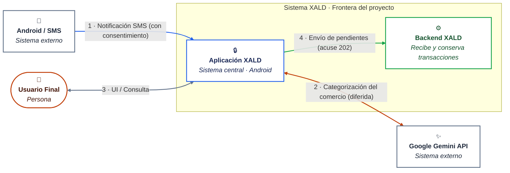

## C1 - Context

| | |
|---|---|
| **Diagrama** | C4 Nivel 1 — Contexto |
| **Estado del código revisado** | Rama `master`, revisión del 22 de noviembre de 2026 |

Este diagrama muestra **quién usa XALD y con qué sistemas externos interactúa**. No incluye detalles de Room, WorkManager ni clases Kotlin: esos están en [C2](c2.md) y [C3](c3.md).

### Leyenda

**Tipos de elemento**

| Color | Tipo | Significado |
|---|---|---|
| Naranja | Persona | Actor humano que interactúa con el sistema |
| Azul | Sistema central | Aplicación móvil Android, núcleo del proyecto |
| Verde | Servidor interno | Backend XALD, dentro de la frontera del sistema |
| Gris | Sistema externo | Servicio de terceros, fuera del control del equipo |

**Tipos de relación**

| Notación | Significado |
|---|---|
| `-->` | Comunicación unidireccional |
| `<-->` | Petición y respuesta |
| Etiqueta numerada | Número del conector, seguido del propósito |

### Descripción de Conectores y Flujo de Interacción

1. **Notificación SMS** (SO Android → Aplicación XALD): canal unidireccional por el cual el sistema operativo entrega el texto del SMS bancario. Requiere el permiso `RECEIVE_SMS` y el consentimiento del usuario; sin consentimiento no se procesa ningún SMS. La app no lee la bandeja de entrada.
2. **Categorización** (Aplicación XALD ↔ Google Gemini API): HTTPS/REST. XALD envía únicamente el nombre del comercio de las transacciones que quedaron «Sin Categorizar» y recibe la categoría. Ocurre en segundo plano, cuando hay conexión; el registro de la transacción no depende de esta llamada.
3. **UI** (Usuario Final ↔ Aplicación XALD): interfaz nativa donde el usuario consulta su saldo, sus transacciones pendientes de sincronizar y su historial.
4. **Sincronización / REST** (Aplicación XALD → Backend XALD): envío de las transacciones pendientes y recepción de un acuse de recibo (202) cuando hay conexión. La aplicación **no descarga ni reconcilia** cambios de otros dispositivos.

### Notas de alcance

- El **Backend XALD** se representa dentro de la frontera del sistema porque está dentro del alcance del proyecto; su función se limita a recibir y conservar transacciones (PostgreSQL), resolviendo versiones repetidas o conflictivas con Last-Write-Wins.
- La **API de Gemini** es un sistema externo; su indisponibilidad no interrumpe el registro de transacciones: la transacción queda «Sin Categorizar» y se reintenta después (ver ESC-02).
- El registro local no espera la respuesta del servidor. La base local todavía no está cifrada en reposo (ver [ADR-0004](../adr/0004-seguridad-y-cifrado.md)).
