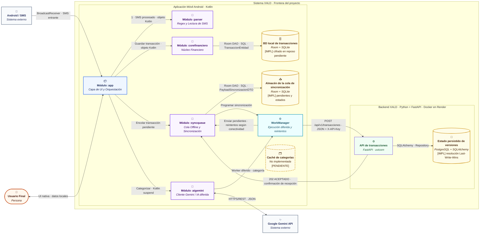

## C2 - Container

### Leyenda (C2 - Contenedores)

| Color / forma | Tipo | Significado |
|---|---|---|
| Naranja | Persona | Usuario que interactúa con XALD |
| Azul | Sistema central | Módulo `:app`: UI y orquestación |
| Morado | Módulo interno | Submódulos Kotlin |
| Verde | Servidor interno | API del Backend XALD |
| Amarillo, cilindro | Almacén de datos | Información persistida |
| Amarillo punteado | Elemento pendiente | Diseñado, pero sin implementación acreditada |
| Celeste | Ejecutor diferido | WorkManager |
| Gris | Sistema externo | Android/SMS y Google Gemini |

### Leyenda de relaciones

| Notación | Significado |
|---|---|
| `-->` | Comunicación o llamada unidireccional |
| `<-->` | Comunicación bidireccional |
| `POST /api/v1/transacciones` | Recepción de una transacción por parte del backend |
| `202 ACEPTADO` | Confirmación de recepción, no descarga ni replicación remota |

### Almacenes de datos y ejecución diferida

Cada almacén tiene un módulo dueño:

| Almacén | Tecnología | Dueño | Qué guarda | Estado |
|---|---|---|---|---|
| **BD local de transacciones** | Room sobre SQLite | `:corefinanciero` | Transacciones, presupuesto, saldo base y movimientos | Implementada; cifrado en reposo pendiente |
| **Almacén de la cola** | Room sobre SQLite | `:syncqueue` | Pendientes, reintentos y estados de envío | Implementado |
| **Caché de categorías** | Sin implementación | `:aigemini` | Categoría por comercio | Pendiente |
| **Estado de versiones** | PostgreSQL + SQLAlchemy | Backend XALD | Última versión por `id_transaccion` para idempotencia y LWW | Implementado |

XALD no usa Kafka, RabbitMQ ni otro broker administrado. La única cola implementada es persistente y está almacenada en la aplicación mediante Room.

WorkManager programa y ejecuta trabajos diferidos. Su ejecución depende de la conectividad disponible y de las restricciones impuestas por Android.

### Flujo principal

1. Android entrega el SMS al receptor.
2. `:app` interpreta y gestiona la transacción.
3. `:corefinanciero` persiste la transacción en Room/SQLite.
4. `:syncqueue` conserva el envío pendiente en Room.
5. WorkManager ejecuta el envío cuando hay conexión.
6. El backend recibe `POST /api/v1/transacciones`.
7. El backend conserva la versión en PostgreSQL y aplica LWW.
8. El cliente recibe la confirmación `202 ACEPTADO`.

Este diagrama representa únicamente subida de transacciones y confirmación. No representa descarga completa, replicación entre dispositivos ni reconciliación bidireccional de cambios remotos.

### IA y categorización

Google Gemini participa en la categorización. Existen dos rutas:

- categorización local durante la ingesta;
- categorización diferida mediante worker y WorkManager.

La clasificación no es necesaria para guardar la transacción localmente. Si falla o no está disponible, la transacción puede conservarse con una categoría pendiente.

### Fronteras de confianza

| Frontera | Elementos | Controles |
|---|---|---|
| **FC-1** Teléfono ↔ SMS | Receptor SMS y base local | Consentimiento y permiso `RECEIVE_SMS`; cifrado local aún pendiente |
| **FC-2** Dispositivo ↔ Gemini | Cliente `:aigemini` y worker | Minimización de datos y configuración segura de credenciales |
| **FC-3** Dispositivo ↔ backend | Cola, WorkManager y API | Autenticación `X-API-Key` y HTTPS en distribución |
| **FC-4** Backend ↔ Internet | API y PostgreSQL | Validación, límites de petición, observabilidad y despliegue controlado |

### Alcance técnico real

- La aplicación registra localmente sin esperar al backend.
- La sincronización se ejecuta de forma asíncrona.
- El backend valida y conserva transacciones en PostgreSQL.
- LWW se aplica según `id_transaccion` y `fecha_transaccion`.
- No se acredita actualmente que el teléfono descargue y reconcilié versiones remotas.

La documentación actual no debe presentar la base local como cifrada ni la sincronización como completa hasta que exista evidencia verificable en código y pruebas.
