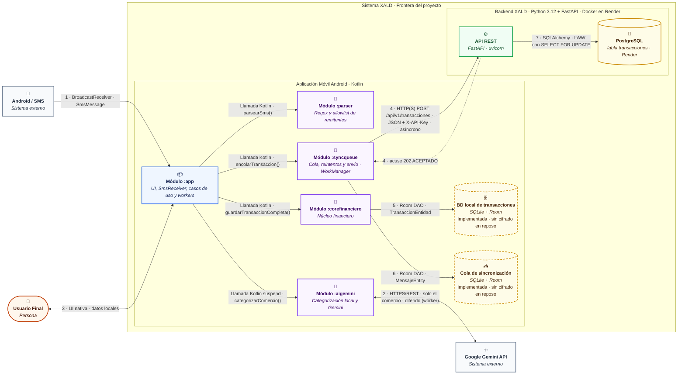

## C2 - Container

| | |
|---|---|
| **Diagrama** | C4 Nivel 2 — Contenedores |
| **Estado del código revisado** | Rama `master`, revisión del 22 de noviembre de 2026 |
| **Fuente única** | Este es el C2 vigente. `docs/c4/c4.md` solo enlaza aquí. |

### Leyenda (C2 - Contenedores)

**Tipos de elemento**

| Color / forma | Tipo | Significado |
|---|---|---|
| Naranja | Persona | Actor humano que interactúa con el sistema |
| Azul | Sistema central | Módulo `:app` (UI y orquestación), núcleo de la aplicación móvil |
| Morado | Módulo interno | Submódulos (`:parser`, `:corefinanciero`, `:syncqueue`, `:aigemini`) |
| Verde | Servidor interno | API del Backend XALD, dentro de la frontera del proyecto |
| Amarillo, cilindro, borde continuo | Almacén implementado | Existe en el código y no tiene brechas declaradas |
| Amarillo, cilindro, borde punteado | Almacén implementado con brecha declarada | Existe en el código, pero sin cifrado en reposo (ADR-0004, ESC-04 abierto) |
| Gris | Sistema externo | Fuera del control del equipo (Android / SMS y Google Gemini API) |

**Tipos de relación**

| Notación | Significado |
|---|---|
| `-->` | Comunicación o llamada unidireccional |
| `-.->` | Respuesta o acuse de recibo |
| `<-->` | Comunicación en ambos sentidos (petición y respuesta) |

> La sincronización con el backend es **de subida con acuse**: la app envía transacciones pendientes y recibe la confirmación (202). La app **no descarga ni reconcilia** cambios de otros dispositivos.

### Almacenes de datos y brokers

Cada almacén tiene **un único módulo dueño** (ver `docs/ownership-matrix.md` y [ADR-0007](../adr/0007-contratos-por-modulo.md)): ningún otro módulo lo lee ni lo escribe directamente.

| Almacén | Tecnología | Dueño | Qué guarda | Estado en el código |
|---|---|---|---|---|
| **BD local de transacciones** | SQLite + Room (`CoreDatabase`) — [ADR-0001](../adr/0001-patron-offline-first.md) | `:corefinanciero` | `TransaccionEntidad`: fuente de verdad del usuario (Offline-First) | **Implementado.** Cifrado en reposo **pendiente** ([ADR-0004](../adr/0004-seguridad-y-cifrado.md), ESC-04). Mitigaciones vigentes: `allowBackup="false"` y solo permiso `RECEIVE_SMS` |
| **Cola de sincronización** | SQLite + Room (`SyncDatabase`) | `:syncqueue` | Mensajes pendientes, fallidos y confirmados, con deduplicación por `id_transaccion@fecha` | **Implementado.** Sin cifrado ([ADR-0014](../adr/0014-sincronizacion-asincrona-con-reintentos.md)) |
| **Caché de categorías** | — | `:aigemini` | — | **No implementada.** Solo diseño (arc42 §8.7); por eso no aparece en el diagrama |
| **PostgreSQL del backend** | PostgreSQL en Render (`TransaccionRegistro`, `backend/app/db.py`) | Backend XALD | Versión vigente de cada transacción, para idempotencia y Last-Write-Wins ([ADR-0011](../adr/0011-resolucion-conflictos-lww.md)) | **Implementado** ([ADR-0018](../adr/0018-persistencia-remota-postgres.md)). El plan Free vence a los 30 días |

**Brokers de mensajes: ninguno.** XALD no usa Kafka, RabbitMQ ni un servicio de colas administrado. La única cola es el almacén local de `:syncqueue`, dentro del dispositivo, y se vacía hacia el backend mediante WorkManager por HTTP(S)/REST. El momento del envío depende de la conectividad y del planificador del sistema. Las garantías (al menos una vez, con consumo idempotente) están en arc42 §8.9. Un broker no aporta nada mientras exista un solo productor por dispositivo y un solo consumidor, y rompería RO-02 (costo $0).

### Fronteras de confianza (semana 13)

El modelo de amenazas STRIDE ([`docs/seguridad/modelo-amenazas.md`](../seguridad/modelo-amenazas.md)) se hizo sobre este diagrama. Cada amenaza nombra el contenedor, almacén o conector numerado que ataca.

| Frontera | Conectores / elementos | Controles principales |
|---|---|---|
| **FC-1** Teléfono ↔ mundo | 1 (Android / SMS → `:app`); almacenes del dispositivo | Consentimiento previo; remitente validado ([ADR-0016](../adr/0016-validacion-del-remitente-sms.md), implementado en `ParseoSms`); `allowBackup="false"`. Cifrado en reposo pendiente |
| **FC-2** Dispositivo ↔ Internet | 2 (`:aigemini` ↔ Gemini), 4 (`:syncqueue` → API) | Solo el comercio va a Gemini ([ADR-0017](../adr/0017-frontera-de-datos-del-componente-generativo.md)); `X-API-Key` rotable ([ADR-0015](../adr/0015-autenticacion-del-cliente-movil.md)). HTTPS en el backend; en la app, HTTP en claro permitido hasta aplicar `network_security_config` |
| **FC-3** Backend ↔ Internet | API REST, PostgreSQL | Límite de tamaño (16 KB), fecha futura rechazada, contenedor sin privilegios, dependencias auditadas |
| **FC-4** Repositorio y pipeline | GitHub Actions → Render | Secretos fuera del código, análisis de dependencias que bloquea el despliegue |

### Descripción de Conectores y Flujo de Interacción

1. **1 · Notificación SMS** (Android / SMS → Módulo `:app`): `BroadcastReceiver` (`SmsReceiver`) de Android; formato `SmsMessage` en texto plano. Requiere permiso `RECEIVE_SMS` y consentimiento del usuario.
2. **2 · Inferencia / JSON** (Módulo `:aigemini` ↔ Google Gemini API): HTTPS/REST mediante el SDK `generativeai`; solo viaja el nombre del comercio. Lo invoca `CategorizacionIaWorker` en segundo plano, no la ingesta.
3. **3 · UI** (Usuario Final ↔ Módulo `:app`): interacción local mediante UI nativa (vistas XML); sin protocolo de red.
4. **4 · Sincronización REST** (Módulo `:syncqueue` → Backend XALD): `POST /api/v1/transacciones` (ver `docs/api/openapi.yaml` y `docs/api/contrato.md`); JSON autenticado con `X-API-Key`. Respuesta `202 ACEPTADO` como acuse de recibo. Asíncrono: la app registra localmente sin esperar al servidor.
5. **5 · Persistencia de transacciones** (`:corefinanciero` → BD local): Room DAO sobre SQLite; formato `TransaccionEntidad`. Es el único camino a la BD local.
6. **6 · Persistencia de la cola** (`:syncqueue` → cola local): Room DAO sobre SQLite; un elemento sale de la cola solo al recibir `2xx` del backend.
7. **7 · Persistencia remota** (API del backend → PostgreSQL): SQLAlchemy; Last-Write-Wins con `SELECT … FOR UPDATE` en `backend/app/repositorio.py`.
8. **Orquestación interna** (Módulo `:app` hacia submódulos): llamadas Kotlin directas en el mismo proceso, sin red; el formato intercambiado son DTOs/objetos Kotlin:
   - **Parser** → `parsearSms()`: recibe remitente y texto crudo, devuelve monto y comercio.
   - **Corefinanciero** → `guardarTransaccionCompleta()`: persiste la transacción con id determinista.
   - **Syncqueue** → `encolarTransaccion()`: encola el payload pendiente.
   - **Aigemini** → `categorizarComercio()` (`suspend`): categoría local inmediata en la ingesta; Gemini en el worker diferido.
