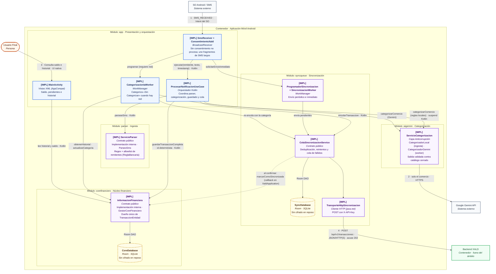

## C3 - Component

| | |
|---|---|
| **Diagrama** | C4 Nivel 3 — Componentes |
| **Ámbito** | Contenedor *Aplicación Móvil Android*, declarado en el [C2](c2.md) |
| **Proyecto** | XALD · Arquitectura de Software |
| **Estado del código revisado** | Rama `master`, revisión del 22 de noviembre de 2026 |

Este diagrama abre el contenedor *Aplicación Móvil Android* y muestra los componentes que lo forman, tal como existen en el código. Cada componente se identifica por su contrato público; la implementación interna se indica dentro de la misma caja. El *Backend XALD* es el otro contenedor del sistema y aquí se representa sin descomponer.

Todos los componentes dibujados están implementados. Las capacidades futuras (cifrado en reposo, caché de categorías, descarga de cambios remotos) **no se dibujan**; ver las notas al final.

### Leyenda (C3 - Componentes)

**Tipos de elemento**

| Color | Borde | Tipo | Significado |
|---|---|---|---|
| Naranja | continuo | Persona | Actor humano que interactúa con el sistema |
| Azul | continuo | Componente de `:app` | Receptor, orquestador, worker y pantalla de la capa de aplicación |
| Morado | continuo | Componente de dominio | Contrato público de un módulo, con su implementación interna |
| Amarillo | punteado | Almacén con brecha declarada | Implementado en Room, pero sin cifrado en reposo |
| Verde | continuo | Contenedor interno | Backend XALD, fuera del ámbito de este diagrama |
| Gris | continuo | Sistema externo | Servicio o plataforma fuera del control del equipo |

**Tipos de relación**

| Notación | Significado |
|---|---|
| `-->` | Llamada o comunicación implementada en el código |
| `-.->` | Callback o confirmación (respuesta diferida) |
| Etiqueta numerada | Conector heredado del [C1](c1.md) y del [C2](c2.md) |
| Etiqueta sin número | Llamada interna al contenedor |

**Prefijo de estado**

| Prefijo | Significado |
|---|---|
| `[IMPL]` | Implementado y presente en el código de la rama `master` |

### Descripción de Conectores y Flujo de Interacción

**Conectores heredados del C1 y del C2**

| # | Conector | Propósito y tecnología | Estado | Decisión que lo sustenta |
|---|---|---|---|---|
| 1 | SO Android → `SmsReceiver` | Recepción pasiva del SMS mediante `BroadcastReceiver`; permiso `RECEIVE_SMS` declarado en el manifiesto; requiere consentimiento del usuario | Implementado | [ADR-0002](../adr/0002-parsing-hibrido.md) · [ADR-0003](../adr/0003-restriccion-os.md) · [ADR-0016](../adr/0016-validacion-del-remitente-sms.md) |
| 2 | `ServicioCategorizacion` → Gemini API | Consulta HTTPS solo con el nombre del comercio, sin datos identificables del usuario. La dispara `CategorizacionIaWorker` en segundo plano, no la ingesta | Implementado (parcial: la llave se compila en el APK; sin caché) | [ADR-0012](../adr/0012-aplazamiento-integracion-gemini.md) · [ADR-0017](../adr/0017-frontera-de-datos-del-componente-generativo.md) |
| 3 | Usuario Final → `MainActivity` | Visualización de saldo, pendientes e historial sobre UI nativa (vistas XML) | Implementado | [ADR-0005](../adr/0005-reduccion-de-funcionalidades.md) |
| 4 | `TransporteHttpSincronizacion` → Backend XALD | Envío de una transacción por petición a `POST /api/v1/transacciones` con `X-API-Key`; el backend responde `202` como acuse. Programado por WorkManager | Implementado | [ADR-0014](../adr/0014-sincronizacion-asincrona-con-reintentos.md) · [ADR-0018](../adr/0018-persistencia-remota-postgres.md) |

**Flujo interno del contenedor**

| # | Relación | Propósito y tecnología | Estado | Decisión que lo sustenta |
|---|---|---|---|---|
| 5 | `SmsReceiver` → `ProcesarNotificacionUseCase` | `ejecutar(remitente, texto, timestamp)`: procesa cada SMS completo, con fragmentos largos ya unidos | Implementado | [ADR-0007](../adr/0007-contratos-por-modulo.md) |
| 6 | `ProcesarNotificacionUseCase` → `ServicioParser` | `parsearSms`: valida el remitente contra la allowlist y devuelve monto y comercio; `ParseoSms` permanece `internal` | Implementado | [ADR-0006](../adr/0006-seleccion-de-estilo-arquitectonico.md) · [ADR-0016](../adr/0016-validacion-del-remitente-sms.md) |
| 7 | `ProcesarNotificacionUseCase` → `ServicioCategorizacion` | `categorizarComercio` con reglas locales (sin red); si no reconoce el comercio, la categoría queda «Sin Categorizar» | Implementado | [ADR-0002](../adr/0002-parsing-hibrido.md) |
| 8 | `ProcesarNotificacionUseCase` → `InformacionFinanciera` | `guardarTransaccionCompleta`: guarda con un id determinista calculado del SMS; un SMS repetido se rechaza | Implementado | [ADR-0001](../adr/0001-patron-offline-first.md) |
| 9 | `ProcesarNotificacionUseCase` → `ColaSincronizacionService` | `encolarTransaccion`: guarda el payload en la cola persistida (Room), con deduplicación | Implementado | [ADR-0014](../adr/0014-sincronizacion-asincrona-con-reintentos.md) |
| 10 | `SmsReceiver` → `ProgramadorSincronizacion` | `solicitarEnvioInmediato`: pide a WorkManager un envío ya; además hay un envío periódico programado desde `XaldApplication` | Implementado | [ADR-0014](../adr/0014-sincronizacion-asincrona-con-reintentos.md) |
| 11 | `SmsReceiver` → `CategorizacionIaWorker` | `programar`: trabajo único con restricción de red y backoff exponencial desde 30 s | Implementado | [ADR-0012](../adr/0012-aplazamiento-integracion-gemini.md) |
| 12 | `CategorizacionIaWorker` → `InformacionFinanciera`, `ServicioCategorizacion` y `ColaSincronizacionService` | Lee las transacciones «Sin Categorizar», pide la categoría a Gemini, la actualiza en el núcleo y re-encola la transacción con el mismo id para que el backend reciba la categoría | Implementado | [ADR-0017](../adr/0017-frontera-de-datos-del-componente-generativo.md) |
| 13 | `ColaSincronizacionService` → `InformacionFinanciera` | Al confirmar el backend un mensaje, un callback (instalado en `XaldApplication`) llama a `marcarComoSincronizada` | Implementado | [ADR-0014](../adr/0014-sincronizacion-asincrona-con-reintentos.md) |
| 14 | `MainActivity` → `InformacionFinanciera` | Lectura de historial, saldo y pendientes para la pantalla | Implementado | [ADR-0005](../adr/0005-reduccion-de-funcionalidades.md) |

### Notas de alcance y coherencia

- **Nota 1 · Contratos y visibilidad.** Los cuatro módulos de dominio exponen una interfaz pública y una función fábrica; sus implementaciones (`ParseoSms`, `CategorizadorGemini`, `GestorCoreFinanciero`, `ColaSincronizacion`) son `internal`, así que el compilador de Kotlin impide que `:app` las referencie directamente. `ValidacionModulosTest` recorre el código fuente y falla si aparece una importación cruzada entre módulos.
- **Nota 2 · Categorización en dos tiempos.** En la ingesta, `CategorizadorLocal` categoriza sin red y la categoría se persiste en `TransaccionEntidad`; lo que no reconoce queda «Sin Categorizar». Después, `CategorizacionIaWorker` pide a Gemini la categoría de esas transacciones y la actualiza. Gemini nunca bloquea el registro. La salida de Gemini solo se acepta si coincide con el catálogo cerrado (`CategoriasPermitidas`).
- **Nota 3 · Persistencia y cifrado.** `:corefinanciero` y `:syncqueue` persisten en Room/SQLite y sobreviven al cierre de la app. El **cifrado en reposo no está implementado** (ADR-0004, ESC-04 abierto), por eso los almacenes aparecen con borde punteado. Mitigaciones vigentes: `allowBackup="false"` y ausencia de `READ_SMS`.
- **Nota 4 · Coherencia entre niveles.** Los cinco módulos de este diagrama corresponden uno a uno con los del C2 y con los proyectos de `settings.gradle.kts`. Los conectores 1 a 4 conservan su numeración del C1 y el C2.
- **Nota 5 · Ubicación del receptor.** El `BroadcastReceiver` de SMS (`SmsReceiver`) está en el módulo `:app`, no en `:parser`. Esto resuelve la discrepancia que antes se mantenía abierta con arc42 §5 y §6.1; esas secciones deben decir lo mismo.
- **Nota 6 · Cobertura de pruebas.** El orquestador tiene `ProcesarNotificacionUseCaseTest`; el consentimiento, `ConsentimientoXaldTest`; la unión de fragmentos de SMS, `AgrupacionSmsTest`; y el aislamiento de módulos, `ValidacionModulosTest`.
- **Nota 7 · Fábrica con respaldo no usada.** `:aigemini` ofrece `crearServicioCategorizacionConRespaldo` (Gemini con reglas locales de respaldo), pero `:app` no la usa: el worker llama a `crearServicioCategorizacion` (solo Gemini) y la ingesta a `crearCategorizadorLocal`.
- **Nota 8 · No incluido en el diagrama.** No hay caché de categorías ni descarga de cambios remotos hacia la app; el cifrado en reposo está pendiente. Ninguno de los tres se dibuja para no sugerir que existe.
- **Nota 9 · Ámbito.** El Backend XALD se descompondría en su propio diagrama de nivel 3; aquí se mantiene como caja cerrada por tratarse de un contenedor distinto.
