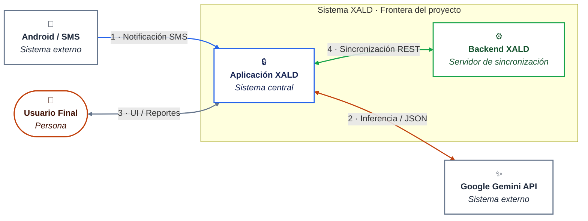
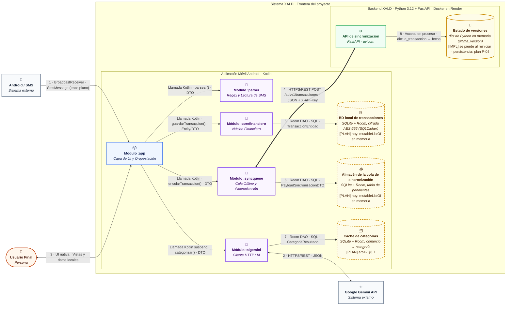

# C4 Model

## Overview

The C4 model is a hierarchical approach to documenting software architecture through four levels of abstraction:

- **C1 - Context**: System overview and its interactions with external systems/users

### Leyenda

**Tipos de elemento**

| Color | Tipo | Significado |
|---|---|---|
| Naranja | Persona | Actor humano que interactúa con el sistema |
| Azul | Sistema central | Aplicación móvil, núcleo del proyecto |
| Verde | Servidor interno | Backend de sincronización, dentro de la frontera del sistema |
| Gris | Sistema externo | Servicio de terceros, fuera del control del equipo |

**Tipos de relación**

| Notación | Significado |
|---|---|
| `-->` | Comunicación unidireccional |
| `<-->` | Comunicación bidireccional |
| Etiqueta numerada | Orden de la interacción dentro del flujo, seguido del protocolo o medio |

### Descripción de Conectores y Flujo de Interacción

1. **Notificación SMS** (SO Android → Aplicación XALD): Canal unidireccional por el cual el sistema operativo entrega el texto plano de la transacción financiera al detector interno del sistema.
2. **Inferencia / JSON** (Aplicación XALD ↔ Google Gemini API): Protocolo de comunicación HTTPS/REST donde XALD envía cadenas de comercios no reconocidos y recibe la categorización normalizada.
3. **UI / Reportes** (Usuario Final ↔ Aplicación XALD): Interfaz gráfica interactiva donde el usuario consulta sus finanzas locales y realiza ajustes directos.
4. **Sincronización / REST** (Aplicación XALD ↔ Backend XALD): Envío de las transacciones pendientes y recepción de los cambios remotos cuando hay conexión disponible.

### Notas de alcance

- El **Backend XALD** se representa dentro de la frontera del sistema porque está dentro del alcance del proyecto; su función se limita a sincronización y persistencia de transacciones.
- La **API de Gemini** se representa como sistema externo y su indisponibilidad no interrumpe el registro de transacciones (ver ESC-02).

## Otros niveles del modelo

- **C2 - Container**: Major technical components and their relationships
- **C3 - Component**: Detailed breakdown of containers and internal structure
- **C4 - Code**: Low-level code structure and implementation details

## Purpose

Provides a clear, scalable way to communicate architecture to different stakeholders at varying levels of detail.

## C2 - Container

### Leyenda (C2 - Contenedores)

**Tipos de elemento**

| Color / forma | Tipo | Significado |
|---|---|---|
| Naranja | Persona | Actor humano que interactúa con el sistema |
| Azul | Sistema central | Módulo `:app` (Capa de UI y Orquestación), núcleo de la aplicación móvil |
| Morado | Módulo interno | Submódulos de la arquitectura modular (`:parser`, `:corefinanciero`, `:syncqueue`, `:aigemini`) |
| Verde | Servidor interno | API del Backend XALD, dentro de la frontera del proyecto |
| Amarillo, cilindro, borde continuo | Almacén de datos implementado | Existe hoy en el código |
| Amarillo, cilindro, borde punteado | Almacén de datos planeado | Diseñado y documentado; el código actual usa un sustituto en memoria |
| Gris | Sistema externo | Servicios o sistemas fuera del control del equipo (Android / SMS y Google Gemini API) |

**Tipos de relación**

| Notación | Significado |
|---|---|
| `-->` | Comunicación y llamada unidireccional |
| `<-->` | Comunicación bidireccional estándar |
| `<==>` | Canal de sincronización REST |

### Almacenes de datos y brokers

Cada almacén tiene **un único módulo dueño** (ver `docs/ownership-matrix.md` y [ADR-0007](../adr/0007-contratos-por-modulo.md)): ningún otro módulo lo lee ni lo escribe directamente.

| Almacén | Tecnología | Dueño | Qué guarda | Estado en el código |
|---|---|---|---|---|
| **BD local de transacciones** | SQLite + Room, cifrada con AES-256 (SQLCipher, llave en Android Keystore) — [ADR-0001](../adr/0001-patron-offline-first.md), [ADR-0004](../adr/0004-seguridad-y-cifrado.md) | `:corefinanciero` | `TransaccionEntidad`: fuente de verdad del usuario (Offline-First) | **Planeado.** Hoy es `mutableListOf` en `GestorCoreFinanciero.kt:11`; no sobrevive al cierre de la app (A-02, `aspectos.md`) |
| **Almacén de la cola de sincronización** | SQLite + Room (tabla de pendientes) | `:syncqueue` | `PayloadSincronizacionDTO` pendientes de enviar, en orden FIFO | **Planeado.** Hoy es `mutableListOf` en `ColaSincronizacion.kt:11` (planes P-01 y P-02, arc42 §11) |
| **Caché de categorías** | SQLite + Room (tabla comercio → categoría) | `:aigemini` | Última categoría aceptada por comercio, para no repetir llamadas a Gemini | **Planeado** (diseño en arc42 §8.7, invalidación en §8.8) |
| **Estado de versiones del backend** | `dict` de Python en memoria del proceso | Backend XALD | `id_transaccion` → `fecha_transaccion` más reciente, para idempotencia y Last-Write-Wins ([ADR-0011](../adr/0011-resolucion-conflictos-lww.md)) | **Implementado** en `backend/app/main.py:60`. Se pierde en cada despliegue o cuando Render duerme el servicio; persistencia con clave única por `id_transaccion` en el plan P-04 |

**Brokers de mensajes: ninguno.** XALD no usa Kafka, RabbitMQ ni un servicio de colas administrado. La única cola es el almacén local de `:syncqueue`, dentro del dispositivo, y se vacía hacia el backend por HTTPS/REST. Las garantías de ese flujo (al menos una vez, con consumo idempotente) están en arc42 §8.9. Un broker no aporta nada mientras exista un solo productor por dispositivo y un solo consumidor, y rompería RO-02 (costo $0).

### Descripción de Conectores y Flujo de Interacción

1. **1 · Notificación SMS** (Android / SMS → Módulo `:app`): protocolo `BroadcastReceiver` de Android; formato `SmsMessage` en texto plano.
2. **2 · Inferencia / JSON** (Módulo `:aigemini` ↔ Google Gemini API): protocolo HTTPS/REST; formato JSON en ambas direcciones (texto del comercio → categoría normalizada).
3. **3 · UI / Reportes** (Usuario Final ↔ Módulo `:app`): interacción local mediante UI nativa; formato de vistas y datos locales del dispositivo, sin protocolo de red.
4. **4 · Sincronización REST** (Módulo `:syncqueue` ⇔ Backend XALD): protocolo HTTPS/REST, endpoint `POST /api/v1/transacciones` (ver `docs/api/openapi.yaml` y `docs/api/contrato.md`); formato JSON, autenticado con cabecera `X-API-Key`.
5. **5 · Persistencia de transacciones** (`:corefinanciero` → BD local): Room DAO sobre SQLite, consultas SQL; formato `TransaccionEntidad`. Es el único camino a la BD local.
6. **6 · Persistencia de la cola** (`:syncqueue` → almacén de la cola): Room DAO sobre SQLite; formato `PayloadSincronizacionDTO`. Un elemento sale de la cola solo al recibir `2xx` del backend (plan P-02).
7. **7 · Caché de categorías** (`:aigemini` → caché): Room DAO sobre SQLite; formato `CategoriaResultado` indexado por comercio.
8. **8 · Estado de versiones** (API del backend → `ultima_version`): acceso en el mismo proceso, sin red; formato `dict` de `id_transaccion` a `fecha_transaccion`.
9. **Orquestación interna** (Módulo `:app` hacia submódulos): llamadas Kotlin directas en el mismo proceso, sin protocolo de red; el formato intercambiado son DTOs/objetos Kotlin (heredado de `c3.md`):
   - **Parser** → `parsear()`, recibe el texto crudo y devuelve monto/comercio.
   - **Corefinanciero** → `guardarTransaccion()`, persiste el DTO como entidad.
   - **Syncqueue** → `encolarTransaccion()`, encola el DTO pendiente.
   - **Aigemini** → `categorizar()` (`suspend`), pide la categoría del comercio.
